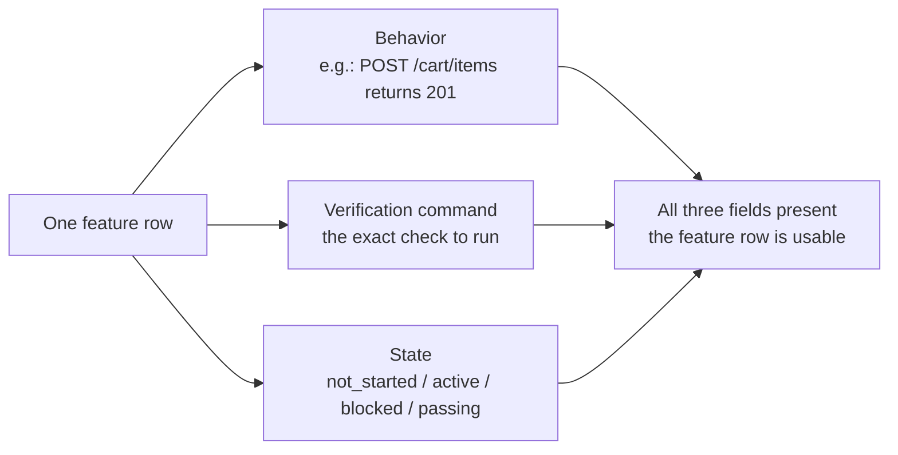
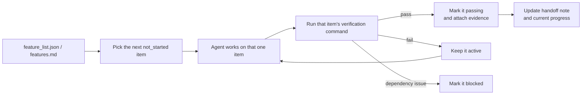

[中文版 →](../../../zh/lectures/lecture-08-why-feature-lists-are-harness-primitives/)

> Code examples: [code/](https://github.com/walkinglabs/learn-harness-engineering/blob/main/docs/en/lectures/lecture-08-why-feature-lists-are-harness-primitives/code/)
> Practice project: [Project 04. Runtime feedback and scope control](./../../projects/project-04-incremental-indexing/index.md)

# Lecture 08. Use Feature Lists to Constrain What the Agent Does

You ask an agent to build an e-commerce site. After it finishes, it tells you "done." You look at the code — user authentication works, but the checkout button in the shopping cart does nothing, and the payment flow isn't connected at all. Where did things go wrong? You never told it what "done" means, so it used its own standard: "I wrote a lot of code and it looks fairly complete."

Feature lists, in many people's eyes, are just a memo — write things down so you don't forget, then toss them aside. But in the harness world, a feature list isn't a memo for humans. It's the foundational structure the entire harness is built on. The scheduler relies on it to pick tasks, the verifier relies on it to judge completion, and the handoff reporter relies on it to generate summaries. Without it, these components have no shared consensus to depend on.

Both Anthropic and OpenAI emphasize: **artifacts must be externalized.** Feature state must live in a machine-readable file in the repo, not in unstructured conversation text.

## Agents Don't Know What "Done" Means

Neither Claude Code nor Codex automatically knows what you mean by "done." You say "add a shopping cart feature," and the model's interpretation might be "write a Cart component and an addToCart method." But you meant "the user can browse products, add to cart, and complete checkout end-to-end."

This understanding gap persists without a feature list. The agent uses its own implicit standard — usually "the code has no obvious syntax errors." What you need is end-to-end behavioral verification. Without a list, the two sides will never agree on what "done" means.

Look at this common progress note:

```
Did user auth, shopping cart mostly done, still need payments
```

Can a new agent session answer these questions from this note? What does "mostly done" mean? Which tests did the cart pass? What's blocking payments? The answer to all is "nobody knows."

The result: the new session has to infer project state, and may end up re-implementing completed features. Anthropic's advice is to [record progress and verification results in versioned files](https://www.anthropic.com/engineering/effective-harnesses-for-long-running-agents) so the next session can inspect state.

## Feature State Machine





## Core Concepts

- **Feature lists are harness primitives**: Not "optional planning tools," but foundational data structures that all other harness components depend on. The scheduler, verifier, and handoff reporter all need to read the feature list to function.
- **Triple structure**: Each feature item contains three elements: `(behavior description, verification command, current state)`. The behavior tells the agent what to do, the verification tells it what counts as done, and the state tells it where things stand. Missing any element makes the item incomplete.
- **State machine model**: Each feature item has four states — `not_started`, `active`, `blocked`, `passing`. State transitions are controlled by the harness, not freely changed by the agent.
- **Pass-state gating**: The only way a feature moves from `active` to `passing` is by the verification command executing successfully. This transition is irreversible — once `passing`, it can't go back.
- **Single source of truth**: All information about "what needs to be done" must derive from one feature list. No contradictions between the feature list and conversation history.
- **Back-pressure**: The number of features that haven't passed yet is the pressure the harness exerts on the agent. Zero pressure = project complete.

## Why Feature Lists Must Be "Primitives"

Documents are for humans to read; primitives are for systems to execute. Documents can be ignored; primitives can't be bypassed.

Think of it like database trigger constraints versus application-layer checks: the former is enforced by the database engine — no SQL can skip it. The latter depends on application code correctness and can be accidentally bypassed. Feature lists as harness primitives play the same role as database-level constraints — the agent cannot bypass them.

Specifically, the feature list serves four harness components:

1. **Scheduler**: Reads states, picks the next `not_started` feature.
2. **Verifier**: Executes verification commands, decides whether to allow state transitions.
3. **Handoff reporter**: Automatically generates session handoff summaries from the feature list.
4. **Progress tracker**: Tallies state distribution, provides project health metrics.

## How to Do It

### 1. Define a Minimal Feature List Format

You don't need a complex system — a structured Markdown or JSON file works. The key is every entry must have the triple:

```json
{
  "id": "F03",
  "behavior": "POST /cart/items with {product_id, quantity} returns 201",
  "verification": "curl -X POST http://localhost:3000/api/cart/items -H 'Content-Type: application/json' -d '{\"product_id\":1,\"quantity\":2}' | jq .status == 201",
  "state": "passing",
  "evidence": "commit abc123, test output log"
}
```

### 2. Let the Harness Control State Transitions

The agent can't directly change a feature's state to `passing`. It can only submit a verification request. The harness executes the verification command and decides whether to allow the transition. This is "pass-state gating."

### 3. Write the Rules in CLAUDE.md

```
## Feature List Rules
- Feature list file: /docs/features.md
- Only one feature active at a time
- Verification command must pass before marking as passing
- Don't modify feature list states yourself — the verification script updates them automatically
```

### 4. Calibrate Granularity

Each feature item should be scoped to "completable in one session." Too broad and it won't finish; too narrow and the management overhead grows. "User can add items to cart" is good granularity. "Implement the shopping cart" is too broad. "Create the name field on the Cart model" is too narrow.

## Real-World Case

An e-commerce platform with 10 features. Two tracking approaches compared:

**Memo mode**: The agent uses unstructured notes to track progress. After 3 sessions, the notes become "did user auth and product list, shopping cart mostly done but has bugs, payments not started." A new session needs 20 minutes to infer state, and ultimately re-implements completed features.

**Structured mode**: Every feature has a clear state and verification command. A new session reads the feature list and in 3 minutes knows: F01-F05 are `passing`, F06 is `active` (in progress), F07-F10 are `not_started`. It picks up directly from F06, with zero rework.

A structured list puts each feature's state and verification command in one place, so the new session knows what is done.

## Key Takeaways

- **Feature lists are the harness's foundational structure**, not memos for humans. The scheduler, verifier, and handoff reporter all depend on them.
- **Every feature item must have the triple**: behavior description + verification command + current state. Missing one element makes it incomplete.
- **State transitions are controlled by the harness** — the agent can't change states on its own. Passing verification is the only upgrade path.
- **The feature list is the project's single source of truth** — all "what to do" information derives from it.
- **Calibrate granularity to "completable in one session."** Too broad and it won't finish; too narrow and you can't manage it.

## Further Reading

- [Building Effective Agents - Anthropic](https://www.anthropic.com/research/building-effective-agents) — Explicitly identifies feature list as the "core data structure" for controlling agent scope
- [Harness Engineering - OpenAI](https://openai.com/index/harness-engineering/) — Emphasizes the principle of "externalizing artifacts"
- [Design by Contract - Bertrand Meyer](https://www.goodreads.com/book/show/130439.Object_Oriented_Software_Construction) — Design by contract principles, the theoretical foundation of feature lists
- [How Google Tests Software](https://books.google.dk/books/about/How_Google_Tests_Software.html?id=VrAx1ATf-RoC&redir_esc=y) — Test pyramid and behavioral specification engineering practices

## Exercises

1. **Feature List Design**: Define a minimal feature list JSON schema. Include: id, behavior description, verification command, current state, evidence reference. Use it to describe a real project with 5 features.

2. **Verification Strictness Comparison**: Pick 3 features and design both a "loose" verification (e.g., "code has no syntax errors") and a "strict" verification (e.g., "end-to-end test passes"). Compare false positive rates under each approach.

3. **Single Source Principle Audit**: Review an existing agent project and check for scope information that contradicts the feature list (implicit requirements in conversations, TODO comments in code, etc.). Design a plan to unify all information into the feature list.
