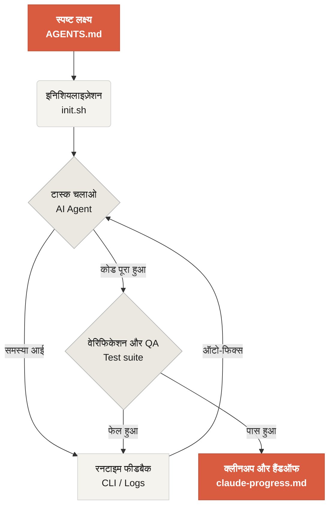

# Learn Harness Engineering में आपका स्वागत है

Learn Harness Engineering एक प्रैक्टिकल, प्रोजेक्ट-बेस्ड कोर्स है जो AI कोडिंग एजेंट्स की इंजीनियरिंग सिखाता है। हमने इंडस्ट्री में हार्नेस इंजीनियरिंग की सबसे एडवांस्ड थ्योरी और प्रैक्टिसेज को गहराई से स्टडी करके इस कोर्स में ढाला है। हमारे मुख्य संदर्भ (references) हैं:
- [OpenAI: Harness engineering: leveraging Codex in an agent-first world](https://openai.com/index/harness-engineering/)
- [Anthropic: Effective harnesses for long-running agents](https://www.anthropic.com/engineering/effective-harnesses-for-long-running-agents)
- [Anthropic: Harness design for long-running application development](https://www.anthropic.com/engineering/harness-design-long-running-apps)
- [Awesome Harness Engineering](https://github.com/walkinglabs/awesome-harness-engineering)

सिस्टमैटिक एनवायरनमेंट डिज़ाइन, स्टेट मैनेजमेंट, वेरिफिकेशन और कंट्रोल सिस्टम्स के ज़रिए, यह कोर्स आपको सिखाता है कि Codex और Claude Code जैसे एजेंटिक कोडिंग टूल्स को असल में **विश्वसनीय और भरोसेमंद** कैसे बनाया जाए। यह आपके AI कोडिंग असिस्टेंट को साफ़-सुथरे नियमों और सीमाओं (rules & boundaries) में बाँधकर नए फीचर्स बनाने, बग्स फिक्स करने और डेवलपमेंट टास्क्स को ऑटोमेट करने में मदद करता है।

## शुरुआत करें (Get started)

शुरू करने के लिए अपना लर्निंग पाथ चुनें। कोर्स को तीन हिस्सों में बाँटा गया है: थ्योरिटिकल लेक्चर्स, हैंड्स-ऑन प्रोजेक्ट्स, और सीधा कॉपी-पेस्ट करने योग्य रेडीमेड रिसोर्स लाइब्रेरी।

  <a href="./lectures/lecture-01-why-capable-agents-still-fail/" class="card">
    <h3>लेक्चर्स (Lectures)</h3>
    
समझिए कि ताकतवर मॉडल्स भी क्यों फेल होते हैं और असरदार हार्नेस के पीछे का साइंस क्या है।

  </a>
  <a href="./projects/" class="card">
    <h3>प्रोजेक्ट्स (Projects)</h3>
    
शुरुआत से एक भरोसेमंद एजेंटिक एनवायरनमेंट तैयार करने की हैंड्स-ऑन प्रैक्टिस।

  </a>
  <a href="./resources/" class="card">
    <h3>रिसोर्स लाइब्रेरी (Resource Library)</h3>
    
अपनी खुद की रिपॉजिटरी में सीधे इस्तेमाल करने के लिए रेडीमेड टेम्पलेट्स (AGENTS.md, feature_list.json)।

  </a>
  <a href="./harness-designs/" class="card">
    <h3>फ्रंटियर हार्नेस डिज़ाइन (Breakdowns)</h3>
    
Pi, Claude Code, Codex और DeepSeek असल में अपना हार्नेस कैसे डिज़ाइन करते हैं — उसका पूरा पोस्टमार्टम।

  </a>

## हार्नेस का कोर मैकेनिज्म (The Core Mechanism)

हार्नेस मॉडल को "ज़्यादा बुद्धिमान" नहीं बनाता; बल्कि यह मॉडल के चारों तरफ एक क्लोज्ड-लूप **वर्किंग सिस्टम** तैयार करता है। इसके कोर वर्कफ्लो को आप इस आसान डायग्राम से समझ सकते हैं:

## आप इस कोर्स में क्या सीखेंगे?

यहाँ कुछ प्रमुख कॉन्सेप्ट्स हैं जिनमें आप महारत हासिल करेंगे:

<ul class="index-list">
  <li><strong>एजेंट के व्यवहार को सीमित करना:</strong> साफ़ नियमों और सीमाओं के ज़रिए एजेंट को भड़कने से रोकना।</li>
  <li><strong>कॉन्टेक्स्ट को बरकरार रखना:</strong> लंबे समय तक चलने वाले और कई सेशन्स वाले टास्क्स में भी प्रोजेक्ट की समझ बनाए रखना।</li>
  <li><strong>एजेंट को समय से पहले जीत का ऐलान करने से रोकना:</strong> काम पूरा हुए बिना एजेंट को "हो गया" कहने से रोकना।</li>
  <li><strong>पूरे पाइपलाइन टेस्ट्स से काम जाँचना:</strong> यूनिट टेस्ट्स, एंड-टू-एंड टेस्ट्स और सेल्फ-रिफ्लेक्शन से कोड वेरिफाई करना।</li>
  <li><strong>रनटाइम को ऑब्ज़र्वेबल बनाना:</strong> एजेंट पर्दे के पीछे क्या कर रहा है, उसे ट्रैक और डिबग करना।</li>
</ul>

## अगले कदम (Next steps)

एक बार बुनियादी कॉन्सेप्ट्स समझ आ जाने के बाद, गहराई में उतरने के लिए इन गाइड्स से शुरुआत करें:

<ul class="index-list">
  <li><a href="./lectures/lecture-01-why-capable-agents-still-fail/">लेक्चर 01: मॉडल कितना भी काबिल हो, इसका मतलब यह नहीं कि वह काम भी भरोसेमंद करेगा</a>: हार्नेस इंजीनियरिंग की थ्योरी से शुरुआत करें।</li>
  <li><a href="./projects/project-01-baseline-vs-minimal-harness/">प्रोजेक्ट 01: केवल प्रॉम्प्ट बनाम नियम-पहले</a>: अपने पहले असली टास्क पर काम करके देखें।</li>
  <li><a href="./resources/templates/">टेम्पलेट्स</a>: अपने प्रोजेक्ट्स के लिए मिनिमल हार्नेस पैक (AGENTS.md, feature_list.json, claude-progress.md) उठाएँ।</li>
</ul>
