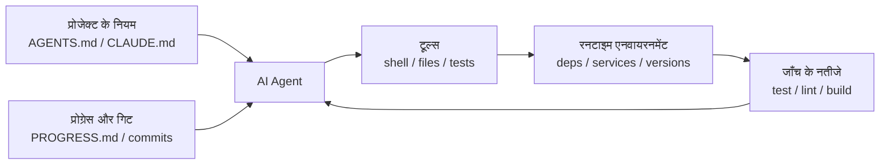

[English Version →](../../../en/lectures/lecture-02-what-a-harness-actually-is/)

> कोड उदाहरण: [code/](https://github.com/walkinglabs/learn-harness-engineering/blob/main/docs/en/lectures/lecture-02-what-a-harness-actually-is/code/)
> प्रैक्टिकल प्रोजेक्ट: [Project 01. केवल प्रॉम्प्ट बनाम नियम-पहले: हार्नेस से कितना फर्क पड़ता है?](./../../projects/project-01-baseline-vs-minimal-harness/index.md)

# लेक्चर 02. हार्नेस असल में क्या होता है

आजकल AI कोडिंग एजेंट की दुनिया में "हार्नेस" (Harness) शब्द बहुत सुनने को मिलता है। लेकिन सच कहें तो ज़्यादातर लोग जब "हार्नेस" कहते हैं, तो उनका मतलब सिर्फ एक प्रॉम्प्ट फ़ाइल से होता है। 

साफ़ समझ लीजिए: **सिर्फ एक प्रॉम्प्ट फ़ाइल कोई हार्नेस नहीं होती।**

इस लेक्चर में हम हार्नेस की एक सटीक और प्रैक्टिकल परिभाषा समझेंगे — कोई किताबी ज्ञान नहीं, बल्कि एक ऐसा फ्रेमवर्क जिसे आप आज ही अपने काम में उतार सकें। एक मुकम्मल हार्नेस में **पाँच सबसिस्टम (Subsystems)** होते हैं: **Instructions (निर्देश)**, **Tools (टूल्स)**, **Environment (एनवायरनमेंट)**, **State (स्टेट)**, और **Feedback (फीडबैक)**। इन पाँचों की अपनी साफ़ ज़िम्मेदारियाँ और परखने के पैमाने हैं।

## एक रोज़मर्रा के उदाहरण से समझते हैं

मान लीजिए आप किसी कंपनी में नए-नवेले सॉफ्टवेयर इंजीनियर बनकर पहुँचे, और आपको एक ऐसे प्रोजेक्ट में झोंक दिया गया जहाँ डॉक्यूमेंटेशन का नामोनिशान नहीं है। न कोई README है, न कोड में कोई कमेंट्स हैं, किसी ने यह नहीं बताया कि टेस्ट कैसे रन होते हैं, और CI कॉन्फ़िग कहीं फाइलों के ढेर में दबी पड़ी है। 

क्या आप ऐसा अच्छा कोड लिख पाएँगे? शायद हाँ — अगर आप हद से ज़्यादा स्मार्ट हैं और कूट-कूट कर सब्र भरा है। लेकिन आपका ज़्यादातर समय "असली प्रॉब्लम सॉल्व करने" में नहीं, बल्कि यह सिर खपाने में गुज़रेगा कि *"भाई, यह प्रोजेक्ट आखिर चल किस चिड़िया के बल पर रहा है?"*

एक AI एजेंट के सामने भी ठीक यही मुसीबत होती है — बल्कि उसकी हालत आपसे भी बदतर होती है। आप तो कम से कम साथ बैठे कलीग से मुँह खोलकर पूछ सकते हैं। लेकिन एजेंट सिर्फ उन्हीं फाइलों को देख सकता है जो आपने उसके सामने रखी हैं और सिर्फ वही कमांड्स चला सकता है जिनकी आपने उसे इजाज़त दी है।

OpenAI ने हार्नेस इंजीनियरिंग का मूल मंत्र दिया है: **"रिपॉजिटरी ही सबसे बड़ा सच है (The repo IS the spec)"** — यानी एजेंट के लिए ज़रूरी सारा कॉन्टेक्स्ट रिपॉजिटरी के अंदर ही मौजूद होना चाहिए; स्ट्रक्चर्ड इंस्ट्रक्शन फाइलों, स्पष्ट वेरिफिकेशन कमांड्स और साफ़-सुथरे फोल्डर स्ट्रक्चर के ज़रिए। वहीं Anthropic के लॉन्ग-रनिंग एजेंट्स डॉक्युमेंटेशन का ज़ोर इस बात पर है कि स्टेट हमेशा पर्सिस्ट (save) रहनी चाहिए, रिकवरी के रास्ते साफ़ होने चाहिए, और प्रोग्रेस ट्रैकिंग स्ट्रक्चर्ड होनी चाहिए। दोनों बड़ी कम्पनियाँ अलग-अलग कोणों से बात कर रही हैं, पर दोनों का सार एक ही है: **मॉडल के वेट्स (weights) के बाहर का इंजीनियरिंग इन्फ्रास्ट्रक्चर ही यह तय करता है कि मॉडल की असल काबिलियत ज़मीन पर कितनी उतर पाएगी।**

ज़रा उन टूल्स को देखिए जिन्हें आप पहले से जानते हैं:

- **Claude Code** पूरी तरह हार्नेस सोच का जीता-जागता उदाहरण है। यह आपकी रिपो से `CLAUDE.md` पढ़ता है, शेल कमांड्स चला सकता है, आपके लोकल एनवायरनमेंट में काम करता है, सेशन हिस्ट्री मेंटेन करता है, और टेस्ट चलाकर रिज़ल्ट्स देख सकता है। लेकिन अगर आप उसे टेस्ट रन करने की कमांड ही नहीं बताएँगे, तो उसके पास यह जानने का कोई रास्ता नहीं बचेगा कि उसने काम सही किया या गलत।
- **Cursor** भी इसी सिद्धांत पर चलता है। उसकी `.cursorrules` फ़ाइल उसके निर्देशों का ज़रिया है, टर्मिनल उसका टूल है, और वह आपके प्रोजेक्ट स्ट्रक्चर और लिंट कॉन्फ़िग को पढ़ सकता है। लेकिन Cursor का स्टेट मैनेजमेंट थोड़ा कच्चा है — जैसे ही आप IDE बंद करके दोबारा खोलते हैं, पिछला कॉन्टेक्स्ट गायब हो जाता है।
- **Codex** (OpenAI का कोडिंग एजेंट) हर टास्क के रनटाइम एनवायरनमेंट को अलग रखने के लिए गिट वर्क-ट्री (git worktrees) का इस्तेमाल करता है, साथ में लोकल ऑब्ज़र्वेबिलिटी स्टैक (logs, metrics, traces) रखता है, ताकि हर बदलाव एक बिल्कुल स्वतंत्र माहौल में टेस्ट हो सके। यह उन रिपॉजिटरीज़ में कहीं ज़्यादा उम्दा काम करता है जहाँ `AGENTS.md` और साफ़ वेरिफिकेशन कमांड्स मौजूद हों।
- **AutoGPT** एक सबक है कि क्या नहीं करना चाहिए। उसमें स्ट्रक्चर्ड स्टेट मैनेजमेंट न होने के कारण लंबे टास्क्स में कॉन्टेक्स्ट कचरे की तरह भरता चला जाता है, और सटीक फीडबैक की कमी की वजह से एजेंट एक ही लूप में चक्कर काटता रहता है। लोग अक्सर कहते हैं कि "AutoGPT काम नहीं करता," पर असलियत यह है कि उसका **हार्नेस** काम नहीं करता।

## मूल अवधारणाएँ (Core Concepts)

- **हार्नेस असल में क्या है:** मॉडल के वेट्स के बाहर जो कुछ भी इंजीनियरिंग इन्फ्रास्ट्रक्चर में मौजूद है, वह सब हार्नेस है। OpenAI के अनुसार एक इंजीनियर का मुख्य काम तीन चीज़ों में सिमट जाता है: एनवायरनमेंट डिज़ाइन करना, अपना इरादा (intent) साफ़ ज़ाहिर करना, और फीडबैक लूप्स तैयार करना। Anthropic तो अपने Claude Agent SDK को सीधे तौर पर एक "जनरल-पर्पस एजेंट हार्नेस" ही कहता है।
- **रिपॉजिटरी एकमात्र सच है (System of Record):** जो चीज़ एजेंट को नहीं दिखती, असल में उसका कोई वजूद ही नहीं है। जो भी कॉन्टेक्स्ट एजेंट के लिए ज़रूरी है, वह सब रिपो के अंदर स्ट्रक्चर्ड फाइल्स के रूप में दर्ज होना चाहिए।
- **नक्शा दीजिए, पोथा नहीं (Give a map, not a manual):** OpenAI का तजुर्बा कहता है कि `AGENTS.md` को एक डायरेक्टरी इंडेक्स होना चाहिए, कोई एनसाइक्लोपीडिया नहीं। लगभग 100 लाइनों की फ़ाइल काफी होती है। अगर बात ज़्यादा लंबी है, तो उसे `docs/` फोल्डर में अलग फाइलों में बाँट दीजिए ताकि एजेंट ज़रूरत पड़ने पर ही उन्हें पढ़े।
- **नियमों से बाँधिए, माइक्रोमैनेज मत कीजिए:** एक बेहतरीन हार्नेस एजेंट को एग्ज़ीक्यूटेबल रूल्स (चलने वाले नियमों) से बाँधता है, न कि हर छोटी-मोटी बात की लिस्ट थमाता है। OpenAI कहता है: *"सिद्धांतों को लागू करवाइए, कोडिंग के एक-एक कदम को माइक्रोमैनेज मत कीजिए।"* Anthropic ने पाया कि एजेंट्स अक्सर अपने ही काम की झूठी तारीफ करने लगते हैं; इसका सबसे बढ़िया तोड़ यह है कि **"काम करने वाले"** और **"काम चेक करने वाले"** को हमेशा अलग रखिए।
- **एक-एक कॉम्पोनेंट हटाकर असर देखिए:** यह जानने के लिए कि हार्नेस का कौन-सा हिस्सा कितना मददगार है, एक-एक करके उन्हें हटाइए और देखिए कि किसके हटने से परफ़ॉर्मेंस में सबसे बड़ी गिरावट आती है। इससे आपको पता चलेगा कि आज की तारीख में सबसे कीमती चीज़ क्या है।

## पाँच सबसिस्टम वाला हार्नेस मॉडल (The Five-Subsystem Harness Model)

शुरुआती उदाहरण पर लौटते हैं। एक पूरे हार्नेस में ये 5 सबसिस्टम होते हैं:



1. **Instruction सबसिस्टम (निर्देश):** अपनी रिपो में `AGENTS.md` (या `CLAUDE.md`) बनाइए, जिसमें प्रोजेक्ट का ओवरव्यू, टेक स्टैक और वर्ज़न्स, पहली बार सेटअप करने की कमांड्स, न टूटने वाले कड़े नियम (hard constraints), और डिटेल्ड डॉक्यूमेंटेशन के लिंक्स हों।
2. **Tool सबसिस्टम (टूल्स):** सुनिश्चित कीजिए कि एजेंट के पास ज़रूरत के सारे टूल्स हों। "सिक्योरिटी" के नाम पर शेल को पूरी तरह ब्लॉक मत कर दीजिए — अगर एजेंट `pip install` या टेस्ट ही नहीं चला पाएगा, तो काम कैसे करेगा? लेकिन सब कुछ खुला भी मत छोड़िए — कम से कम ज़रूरी अधिकार (least privilege) का नियम अपनाइए।
3. **Environment सबसिस्टम (एनवायरनमेंट):** अपने एनवायरनमेंट को ऐसा बनाइए जो खुद अपनी पहचान बता सके। डिपेंडेंसीज़ लॉक करने के लिए `pyproject.toml` या `package.json` का इस्तेमाल कीजिए, वर्ज़न्स फिक्स करने के लिए `.nvmrc` या `.python-version` रखिए, और एनवायरनमेंट को दोहराने योग्य बनाने के लिए Docker या devcontainers का इस्तेमाल कीजिए।
4. **State सबसिस्टम (स्टेट):** लंबे समय तक चलने वाले टास्क्स में प्रोग्रेस ट्रैक होना बेहद ज़रूरी है। एक सादा `PROGRESS.md` फ़ाइल रखिए जिसमें लिखा हो: क्या हो चुका है, अभी क्या चल रहा है, और कहाँ रुकावट है। हर सेशन खत्म होने से पहले इसे अपडेट कीजिए और नया सेशन शुरू होते ही सबसे पहले इसे पढ़िए।
5. **Feedback सबसिस्टम (फीडबैक):** यह सबसे कम मेहनत में सबसे ज़्यादा फायदा (Highest ROI) देने वाला सबसिस्टम है! `AGENTS.md` में सीधे और स्पष्ट वेरिफिकेशन कमांड्स लिख दीजिए:
   ```bash
   वेरिफिकेशन कमांड्स:
   - Tests: pytest tests/ -x
   - Type check: mypy src/ --strict
   - Lint: ruff check src/
   - Full verification: make check (ऊपर के सारे टेस्ट्स एक साथ)
   ```

इन पाँचों में से अगर एक भी सबसिस्टम गायब हुआ, तो आपका हार्नेस अधूरा रहेगा और एजेंट हर कदम पर लड़खड़ाएगा।

## एक टीम की सच्ची कहानी

एक टीम ने GPT-4o का इस्तेमाल करके TypeScript + React में एक फ्रंटएंड ऐप्लिकेशन बनाया (लगभग 20,000 लाइन्स ऑफ कोड)। वे चार चरणों से गुज़रे, जो असल में एक-एक करके हार्नेस सबसिस्टम्स जोड़ने की कहानी है:

- **स्टेज 1:** README में केवल प्रोजेक्ट का बेसिक परिचय था। 5 में से सिर्फ 1 रन सफल रहा (**20% सक्सेस रेट**)। मुख्य गड़बड़ी: गलत पैकेज मैनेजर चुन लिया (npm बनाम yarn), कंपोनेंट नेमिंग कन्वेंशन तोड़ा, और टेस्ट नहीं चला पाया।
- **स्टेज 2:** रिपो में `AGENTS.md` जोड़ी जिसमें टेक स्टैक, नेमिंग कन्वेंशन और मुख्य आर्किटेक्चर नियम लिखे थे। सक्सेस रेट बढ़कर **60%** हो गया। बाकी फेलियर्स एनवायरनमेंट और मिसिंग वेरिफिकेशन की वजह से थे।
- **स्टेज 3:** `AGENTS.md` में साफ-साफ वेरिफिकेशन कमांड्स जोड़ दी गईं: `yarn test && yarn lint && yarn build`। सक्सेस रेट उछलकर **80%** पहुँच गया!
- **स्टेज 4:** एक प्रोग्रेस फ़ाइल जोड़ी गई जहाँ एजेंट हर रन के बाद पूरा हुआ और अधूरा काम दर्ज करता था। सक्सेस रेट **80-100%** पर जाकर स्थिर हो गया।

चार इटरेशन्स, मॉडल में एक पैसे का बदलाव नहीं हुआ, और सफलता की दर 20% से सीधे 100% के करीब पहुँच गई! आपने कोई नया या महँगा मॉडल नहीं खरीदा था — जो बदला, वह था आपका **हार्नेस**।

## मुख्य सीख (Key Takeaways)

- **Harness = Instructions + Tools + Environment + State + Feedback.** ये पाँचों सबसिस्टम्स मिलकर ही एक मुकम्मल सिस्टम बनाते हैं।
- अगर कोई चीज़ मॉडल के वेट्स का हिस्सा नहीं है, तो वह हार्नेस है। आपका हार्नेस ही यह तय करता है कि मॉडल अपनी ताकत का कितना इस्तेमाल कर पाएगा।
- पाँचों सबसिस्टम्स में, **फीडबैक सबसिस्टम** सबसे कम निवेश में सबसे बड़ा रिटर्न देता है। सबसे पहले अपनी वेरिफिकेशन कमांड्स दुरुस्त कीजिए।
- कोड की तरह हार्नेस में भी दीमक (rotting) लगती है। समय-समय पर इसका ऑडिट कीजिए, और जैसे टेक्निकल डेब्ट चुकाते हैं, वैसे ही हार्नेस डेब्ट को भी साफ़ करते रहिए।

## आगे पढ़ें (Further Reading)

- [OpenAI: Harness Engineering](https://openai.com/index/harness-engineering/)
- [Anthropic: Effective Harnesses for Long-Running Agents](https://www.anthropic.com/engineering/effective-harnesses-for-long-running-agents)
- [HumanLayer: Harness Engineering for Coding Agents](https://www.humanlayer.dev/blog/skill-issue-harness-engineering-for-coding-agents)
- [SWE-agent: Agent-Computer Interfaces](https://github.com/princeton-nlp/SWE-agent)
- [Thoughtworks: Harness Engineering on Technology Radar](https://www.thoughtworks.com/radar)

## अभ्यास (Exercises)

1. **फाइव-टुपल हार्नेस ऑडिट:** अपने किसी ऐसे प्रोजेक्ट को चुनिए जहाँ आप AI एजेंट इस्तेमाल करते हैं। इन पाँचों सबसिस्टम्स (Instructions, Tools, Environment, State, Feedback) को 1 से 5 के स्केल पर रेट कीजिए। जिस सबसिस्टम का स्कोर सबसे कम हो, उस पर 30 मिनट लगाकर सुधार कीजिए, और फिर एजेंट के परफ़ॉर्मेंस में फर्क देखिए।
2. **कंट्रोल्ड वेरिएबल टेस्ट:** एक मॉडल और एक कठिन टास्क चुनिए। बारी-बारी से एक-एक सबसिस्टम हटाइए (जैसे `AGENTS.md` डिलीट करना, या वेरिफिकेशन कमांड्स हटाना), और देखिए कि किस चीज़ के हटने से परफ़ॉर्मेंस में सबसे बड़ा झटका लगता है।
3. **अफोर्डेंस एनालिसिस (Affordance Analysis):** अपने प्रोजेक्ट में ऐसी स्थिति ढूँढिए जहाँ एजेंट "कुछ करना तो चाहता है पर कर नहीं पाता" (जैसे उसे पता है कि पैरामीटर वाली क्वेरी लिखनी चाहिए, पर आपके प्रोजेक्ट के ORM का तरीका नहीं पता)। यह समझिए कि यह चलाने की समस्या है (Gulf of Execution) या जाँचने की (Gulf of Evaluation), और फिर हार्नेस में उस कमी को दूर कीजिए।
