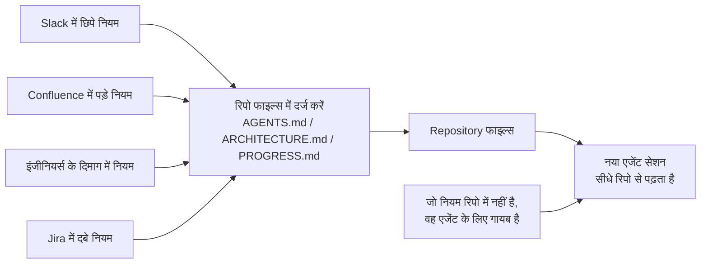
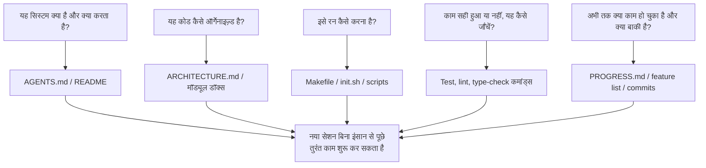

[English Version →](../../../en/lectures/lecture-03-why-the-repository-must-become-the-system-of-record/)

> कोड उदाहरण: [code/](https://github.com/walkinglabs/learn-harness-engineering/blob/main/docs/en/lectures/lecture-03-why-the-repository-must-become-the-system-of-record/code/)
> प्रैक्टिकल प्रोजेक्ट: [Project 02. एजेंट को प्रोजेक्ट पढ़ना सिखाएं और वहीं से काम शुरू करवाएं जहाँ छोड़ा था](./../../projects/project-02-agent-readable-workspace/index.md)

# लेक्चर 03. रिपॉजिटरी को एकमात्र सच क्यों बनना होगा

आपकी टीम के आर्किटेक्चर के फ़ैसले कहाँ दर्ज होते हैं? थोड़े Confluence में, थोड़े Slack की चैट्स में, थोड़े Jira टिकट्स में, और बाकी कुछ सीनियर इंजीनियर्स के दिमाग में। इंसानों के लिए यह जुगाड़ जैसे-तैसे चल जाता है — आप किसी कलीग से पूछ लेते हैं, चैट हिस्ट्री सर्च कर लेते हैं, या ब्रेक रूम में किसी सीनियर को पकड़ लेते हैं। 

लेकिन एक AI एजेंट के लिए? **जो जानकारी रिपॉजिटरी में नहीं है, असल में उसका कोई वजूद ही नहीं है।**

यह कोई बढ़ा-चढ़ाकर कही गई बात नहीं है। एजेंट के पास इनपुट के केवल तीन ही ज़रिए होते हैं:
1. सिस्टम प्रॉम्प्ट्स और आपका दिया हुआ टास्क डिस्क्रिप्शन,
2. रिपॉजिटरी के अंदर की फाइल्स का कंटेंट, और
3. उसके चलाए गए टूल्स का आउटपुट।

आपकी स्लैक हिस्ट्री, जीरा टिकट्स, कॉन्फ्लुएंस पेज, या शुक्रवार की शाम को चाय पर लिया गया आर्किटेक्चर का वो बड़ा फ़ैसला — एजेंट इनमें से कुछ भी नहीं देख सकता! वह किसी इंसान से पूछने नहीं जा सकता और न ही पुरानी चैट्स खंगाल सकता है। उसकी पूरी कायनात सिर्फ आपकी **गिट रिपॉजिटरी** ही है। उसके बाहर की दुनिया के बारे में वह बिल्कुल अनजान है।

तो असली सवाल यह है: **क्या आप एजेंट को एक ऐसा नक्शा दे रहे हैं जिसके सहारे वह बिना भटके काम कर सके?**

## उस नक्शे पर क्या होना चाहिए?

OpenAI ने अपने हार्नेस इंजीनियरिंग आर्टिकल में इसे बहुत साफ़ लफ़्ज़ों में कहा है: **"रिपॉजिटरी ही स्पेसिफिकेशन है (The repo IS the spec)"** — यानी रिपॉजिटरी खुद सबसे बड़ा और आधिकारिक दस्तावेज़ है।

Anthropic के रिसर्चर्स भी इसी बात को दोहराते हैं: लंबे समय तक चलने वाले टास्क्स में निरंतरता बनाए रखने के लिए स्टेट का पर्सिस्टेंट (सुरक्षित) रहना पहली शर्त है। और यह स्टेट रिपॉजिटरी के अंदर ही होनी चाहिए — क्योंकि एजेंट के पास केवल वही एक स्थिर और भरोसेमंद स्टोरेज है जहाँ से वह कभी भी जानकारी पढ़ सकता है।

आप सोच सकते हैं: *"हमारी टीम तो छोटी है, सारी बातें सबके दिमाग में हैं, और हमारा काम मजे से चल रहा है।"* इंसानों के लिए यह सच हो सकता है। लेकिन अगर आप AI एजेंट से काम कराना चाहते हैं, तो आपको एक कड़वा सच कबूल करना होगा: एजेंट इंसानों से बातें नहीं कर सकता। जो कुछ भी उसे जानना है, वह सब लिखा हुआ होना चाहिए — और ऐसी जगह होना चाहिए जहाँ वह उसे आसानी से ढूँढ सके।

यह "ज़्यादा से ज़्यादा डॉक्यूमेंटेशन लिखने" की बात नहीं है — यह **"सही जानकारी को सही जगह रखने"** की बात है। `src/api/` फोल्डर के अंदर रखी 50 लाइनों की एक छोटी `ARCHITECTURE.md` फ़ाइल, Confluence में पड़ी 500 पन्नों की उस धूल खाती डॉक से हज़ारों गुना ज़्यादा कीमती है जिसे कोई मेंटेन नहीं करता। लंबाई से ज़्यादा नज़दीकी मायने रखती है; क्योंकि जानकारी तभी काम आती है जब वह ठीक उसी वक्त हाथ में हो जब उसकी ज़रूरत पड़े।

## नॉलेज विजिबिलिटी (Knowledge Visibility)



आप कैसे पता करेंगे कि आपका नक्शा वाकई अच्छा है? इसके लिए एक **"फ्रेश सेशन टेस्ट" (Fresh Session Test)** कीजिए: एक बिल्कुल नया एजेंट सेशन खोलिए, उसे केवल अपनी रिपॉजिटरी का एक्सेस दीजिए, और देखिए कि क्या वह इन 5 बुनियादी सवालों के जवाब दे पाता है:



अगर एजेंट इनमें से किसी भी सवाल का जवाब नहीं दे पाता, तो समझ लीजिए कि आपके नक्शे में खाली गड्ढे (blank spots) हैं। जहाँ नक्शा खाली होता है, वहाँ एजेंट तुक्के लगाना शुरू करता है — और गलत तुक्के बग्स बनते हैं, कॉन्टेक्स्ट विंडो का कचरा करते हैं, और हर नया सेशन फिर से ज़ीरो से तुक्के लगाने लगता है। तुक्के लगवाने का नुकसान हमेशा नक्शा साफ़ बनाने की मेहनत से कहीं ज़्यादा भारी पड़ता है।

## मूल अवधारणाएँ (Core Concepts)

- **Knowledge Visibility Gap (छिपे हुए ज्ञान का फासला):** प्रोजेक्ट के पूरे ज्ञान का वह हिस्सा जो रिपॉजिटरी में दर्ज *नहीं* है। यह गैप जितना बड़ा होगा, एजेंट के फेल होने का खतरा उतना ही ज़्यादा होगा।
- **System of Record (एकमात्र सच):** कोड रिपॉजिटरी ही प्रोजेक्ट के फैसलों, आर्किटेक्चर नियमों, करंट स्टेट और वेरिफिकेशन का सुप्रीम कोर्ट है। जो रिपो में लिखा है, वही अंतिम सच है — बाहर की किसी बात की कोई मान्यता नहीं।
- **Fresh Session Test (ताज़ा सेशन टेस्ट):** ऊपर दिए गए 5 सवाल। एजेंट जितने सवालों के सटीक जवाब दे पाता है, आपका रिपो उतना ही एजेंट-फ्रेंडली है।
- **Discovery Cost (खोजने की कीमत):** रिपो में कोई ज़रूरी जानकारी ढूँढने के लिए एजेंट अपनी कॉन्टेक्स्ट विंडो का कितना बजट स्वाहा करता है। जानकारी जितनी गहराई में छुपी होगी, खोजने का खर्च उतना बढ़ेगा और असली कोडिंग के लिए कम जगह बचेगी। ज़रूरी बातें हमेशा फ्रंट पर होनी चाहिए।
- **Knowledge Decay Rate (डॉक्यूमेंटेशन की एक्सपायरी):** समय के साथ रिपो के अंदर की जानकारी कितनी पुरानी और अप्रचलित (stale) हो रही है। कोड कुछ और कह रहा है और डॉक कुछ और — यह बिना डॉक्यूमेंटेशन होने से भी ज़्यादा खतरनाक स्थिति है।

## एक बेहतरीन नक्शा कैसे बनाएँ?

1. **सिद्धांत 1: नियम हमेशा कोड के बगल में रहें:** अगर API एंडपॉइंट्स के ऑथेंटिकेशन का कोई खास नियम है, तो वह किसी विशालकाय ग्लोबल डॉक्यूमेंट में नहीं, बल्कि सीधे API वाले फोल्डर के अंदर एक छोटी फ़ाइल में होना चाहिए। जब एजेंट कोड तक पहुँचेगा, तो नियम अपने आप उसकी आँखों के सामने आ जाएँगे।
2. **सिद्धांत 2: एक स्टैंडर्ड एंट्री फ़ाइल (`AGENTS.md`):** यह एजेंट का लैंडिंग पेज है। इसमें सारी दुनिया भर की बातें नहीं होनी चाहिए; बस 50 से 100 लाइनों में तीन सवालों के जवाब होने चाहिए: "प्रोजेक्ट क्या है", "इसे रन कैसे करें", और "इसे वेरिफाई कैसे करें"।
3. **सिद्धांत 3: कम से कम, पर मुकम्मल (Minimal but complete):** हर नियम का एक साफ़ मकसद होना चाहिए। अगर किसी लाइन को हटाने से एजेंट के काम पर कोई फर्क नहीं पड़ता, तो उस लाइन को हटा दीजिए। पर फ्रेश सेशन टेस्ट के पाँचों सवालों के जवाब ज़रूर होने चाहिए।
4. **सिद्धांत 4: कोड बदले तो नियम भी बदलें:** जब भी कोई कोड मॉडिफाई हो, उसके साथ ही उसके आर्किटेक्चर डॉक्यूमेंट को भी अपडेट करने की आदत डालिए।

**रिपॉजिटरी का एक आदर्श ढांचा:**
```text
project/
├── AGENTS.md              # एंट्री पॉइंट: ओवरव्यू, रन कमांड्स, हार्ड रूल्स
├── src/
│   ├── api/
│   │   ├── ARCHITECTURE.md  # API लेयर के आर्किटेक्चर के फैसले
│   │   └── ...
│   ├── db/
│   │   ├── CONSTRAINTS.md   # डेटाबेस के कड़े नियम और माइग्रेशन गाइड
│   │   └── ...
│   └── ...
├── PROGRESS.md             # मौजूदा प्रोग्रेस: क्या हुआ, क्या चल रहा है, क्या अटका है
└── Makefile                # स्टैंडर्ड कमांड्स: setup, test, lint, check
```

## डेटाबेस के ACID नियमों से एजेंट की स्टेट संभालें

यह सादृश्य (analogy) डेटाबेस ट्रांजेक्शन से आता है। सुनने में यह भारी-भरकम लग सकता है, लेकिन एजेंट के लिए यह बहुत ही व्यावहारिक नियम है:

- **Atomicity (पूर्णता):** एजेंट का कोई भी लॉजिकल ऑपरेशन (जैसे कोई एंडपॉइंट जोड़ना और उसके टेस्ट्स अपडेट करना) तभी कमिट होना चाहिए जब वह पूरी तरह कम्प्लीट और वेरिफाइड हो। अधूरा या टूटा हुआ काम गिट में कभी कमिट नहीं होना चाहिए — या तो पूरा काम, या कुछ भी नहीं।
- **Consistency (स्थिरता):** हर ऑपरेशन के बाद सिस्टम एक सही और जाँची-परखी स्थिति में होना चाहिए — सारे टेस्ट पास हों, टाइप-चेक ग्रीन हो। बीच की टूटी-फूटी स्टेट कभी गिट में नहीं जानी चाहिए।
- **Isolation (अलगाव):** जब एक साथ कई एजेंट्स काम कर रहे हों, तो उनके स्टेट फाइल्स अलग रखिए ताकि वे एक-दूसरे के काम पर न चढ़ें। सबसे आसान तरीका: गिट की अलग-अलग ब्रांचेस (या worktrees) इस्तेमाल करना।
- **Durability (स्थायित्व):** महत्वपूर्ण जानकारी को हमेशा गिट-ट्रैक्ड फाइल्स में लिखिए। चैट हिस्ट्री अस्थायी है; जो बात सेशन्स के पार बचनी चाहिए, उसका फाइल्स में दर्ज होना लाज़मी है।

## मुख्य सीख (Key Takeaways)

- जो बात रिपॉजिटरी में नहीं लिखी, वह एजेंट के लिए अस्तित्वहीन है। महत्वपूर्ण निर्णयों को रिपो में दर्ज करना ही हार्नेस इंजीनियरिंग की नींव है।
- अपने रिपो को परखने के लिए **"फ्रेश सेशन टेस्ट"** अपनाइए: क्या एक बिल्कुल नया एजेंट बिना किसी इंसान की मदद के काम शुरू कर सकता है?
- जानकारी हमेशा कोड के करीब होनी चाहिए, संक्षिप्त लेकिन पूरी होनी चाहिए, और कोड के साथ ही अपडेट होनी चाहिए।
- पुरानी पड़ चुकी डॉक्यूमेंटेशन बिना डॉक्यूमेंटेशन होने से ज़्यादा खतरनाक है — क्योंकि वह एजेंट को गुमराह करती है जबकि एजेंट सोचता है कि वह सही रास्ते पर है।

## आगे पढ़ें (Further Reading)

- [OpenAI: Harness Engineering](https://openai.com/index/harness-engineering/)
- [Anthropic: Effective Harnesses for Long-Running Agents](https://www.anthropic.com/engineering/effective-harnesses-for-long-running-agents)
- [ADR: Architecture Decision Records](https://adr.github.io/)
- [The Twelve-Factor App](https://12factor.net/)

## अभ्यास (Exercises)

1. **फ्रेश सेशन टेस्ट करें:** अपने मौजूदा प्रोजेक्ट में एक बिल्कुल नया एजेंट सेशन खोलिए। उसे मुँह से कोई संदर्भ मत दीजिए। उससे 5 सवाल पूछिए: यह सिस्टम क्या है? इसका ढांचा कैसा है? इसे कैसे चलाएँ? कैसे टेस्ट करें? अभी क्या चल रहा है? देखिए वह कहाँ अटकता है, और फिर अपनी रिपो में उस कमी को पूरा कीजिए।
2. **नॉलेज विजिबिलिटी गैप नापिए:** अपनी टीम के 10 मुख्य आर्किटेक्चर नियमों की लिस्ट बनाइए। देखिए उनमें से कितने कोड रिपो में मौजूद हैं और कितने सिर्फ लोगों के दिमाग या पुरानी चैट्स में हैं। जो बाहर हैं, उन्हें आज ही रिपो में ले आइए।
