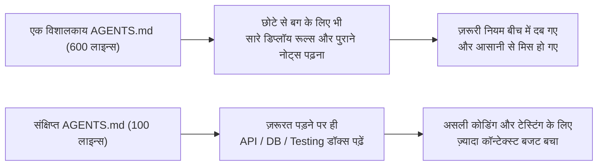

[English Version →](../../../en/lectures/lecture-04-why-one-giant-instruction-file-fails/)

> कोड उदाहरण: [code/](https://github.com/walkinglabs/learn-harness-engineering/blob/main/docs/en/lectures/lecture-04-why-one-giant-instruction-file-fails/code/)
> प्रैक्टिकल प्रोजेक्ट: [Project 02. एजेंट-रीडेबल वर्कस्पेस](./../../projects/project-02-agent-readable-workspace/index.md)

# लेक्चर 04. एक ही बड़ी इंस्ट्रक्शन फ़ाइल क्यों फेल होती है

आपने हार्नेस इंजीनियरिंग को गंभीरता से लेना शुरू किया — बहुत अच्छी बात है! आपने प्रोजेक्ट के रूट में एक `AGENTS.md` फ़ाइल बनाई और जितने भी नियम, बंदिशें और पुराने सबक याद आए, सब उसमें भर दिए। 

एक महीने बाद फ़ाइल 300 लाइनों की हो गई; दो महीने बाद 450; और तीन महीने बाद 600 लाइनों का पोथा बन गई!

फिर आपने एक अजीब बात नोटिस की: **एजेंट का परफ़ॉर्मेंस सुधरने के बजाय और ख़राब होने लगा!**
- एक मामूली सा बग फिक्स करने के लिए भी एजेंट फालतू के डिप्लॉयमेंट रूल्स पढ़ने में आधी कॉन्टेक्स्ट विंडो फूँक देता है।
- लाइन नंबर 300 पर दबा हुआ सिक्योरिटी का एक बेहद ज़रूरी नियम एजेंट की नज़र से पूरी तरह छूट जाता है।
- तीन पुराने और आपस में टकराते हुए कोड-स्टाइल रूल्स की वजह से एजेंट हर बार सिक्का उछालकर कोई भी एक नियम चुन लेता है।

इसे कहते हैं **"विशालकाय इंस्ट्रक्शन फ़ाइल का जाल" (The Giant Instruction File Trap)**। ऊपर से देखने में हर नियम ज़रूरी लगता है, इसलिए आप सब कुछ उसी एक फ़ाइल में ठूँसते चले जाते हैं। नतीजा? आपने 600 लाइनें लिखीं, पर उस वक्त के टास्क के लिए उसमें से एक-तिहाई भी काम की नहीं थीं!

## इस बर्बादी के पीछे का दुष्चक्र (The Vicious Cycle)

यह दुष्चक्र आमतौर पर ऐसे शुरू होता है:
1. एजेंट कोई गलती करता है।
2. आप सोचते हैं: *"लाओ, एक नया नियम जोड़ देता हूँ ताकि दोबारा ऐसी गलती न हो।"*
3. आप `AGENTS.md` में एक नई लाइन जोड़ देते हैं — और थोड़े समय के लिए काम चल जाता है।
4. कुछ दिन बाद एजेंट कोई दूसरी गलती करता है, आप एक और नियम जोड़ देते हैं।
5. यह सिलसिला तब तक चलता है जब तक फ़ाइल एक बेकाबू राक्षस नहीं बन जाती!

गलती होने पर नियम जोड़ना एक स्वाभाविक मानवीय प्रतिक्रिया है। लेकिन इसका कुल असर भयानक होता है:

- **कॉन्टेक्स्ट बजट की बलि चढ़ जाती है:** एजेंट की कॉन्टेक्स्ट विंडो सीमित होती है। अगर आपकी 600 लाइनों की फ़ाइल ही 15,000-20,000 टोकन्स खा जाएगी, तो जब एजेंट को असली कोड पढ़ना होगा, तब तक तो उसका दिमाग (बजट) पहले ही भर चुका होगा!
- **Lost in the Middle (बीच में खो जाना):** रिसर्च (Liu et al., 2023) ने साफ़ साबित किया है कि LLMs लंबे टेक्स्ट के **शुरुआत और अंत** की बातों को बहुत अच्छे से याद रखते हैं, लेकिन **बीच के हिस्से** को नज़रअंदाज़ कर देते हैं। अगर आपकी 600 लाइनों की फ़ाइल की 300वीं लाइन पर लिखा है: *"सारे डेटाबेस क्वेरीज़ पैरामीटराइज़्ड होने चाहिए"* — तो मानकर चलिए कि एजेंट उसे 90% चांस है कि मिस कर देगा!
- **प्राथमिकता की खिचड़ी (Priority Conflicts):** उसी फ़ाइल में आपने कड़ा नियम भी लिखा है ("eval() कभी यूज़ मत करना"), डिज़ाइन गाइडलाइन भी लिखी है ("फंक्शनल स्टाइल पसंद करें"), और पिछले हफ्ते का एक छोटा-सा किस्सा भी लिखा है ("पिछले हफ्ते वेबसॉकेट मेमोरी लीक हुई थी, ध्यान रखना")। ये तीनों बातें अलग-अलग अहमियत रखती हैं, लेकिन फ़ाइल में सब एक जैसी दिखती हैं। एजेंट समझ ही नहीं पाता कि कौन सी लक्ष्मण रेखा है और कौन सा सिर्फ एक सुझाव।
- **रखरखाव का सिरदर्द (Maintenance Decay):** बड़े फाइल्स को कोई साफ़ नहीं करता। पुराने नियम हटाने में सबको डर लगता है कि *"पता नहीं इसे हटाया तो क्या टूट जाएगा!"*, लेकिन नया नियम जोड़ना मुफ़्त लगता है। नतीजा: फ़ाइल सिर्फ बढ़ती है, घटती कभी नहीं।

## मूल अवधारणाएँ (Core Concepts)

- **Instruction Bloat (निर्देशों का मोटापा):** जब इंस्ट्रक्शन फ़ाइल ही कॉन्टेक्स्ट विंडो का 10-15% हिस्सा घेरने लगे, तो वह असली कोडिंग के लिए जगह छीनने लगती है।
- **Lost in the Middle:** लंबे दस्तावेज़ों के बीच में छिपी जानकारी का आसानी से गायब हो जाना।
- **Instruction Signal-to-Noise Ratio (SNR - काम की बात बनाम शोर):** फ़ाइल के कुल निर्देशों में से कितने प्रतिशत निर्देश *मौजूदा टास्क* के लिए प्रासंगिक हैं। एक छोटा CSS बग फिक्स करते समय 50 लाइनों के Kubernetes डिप्लॉयमेंट रूल्स पढ़ना — यह बहुत ही घटिया SNR है।
- **Entry File (प्रवेश द्वार):** एक संक्षिप्त 50-100 लाइनों की फ़ाइल जिसका काम एजेंट को पूरी दुनिया का ज्ञान देना नहीं, बल्कि यह बताना है कि *"कौन सी जानकारी किस फ़ाइल में मिलेगी" (Router)*।
- **Reveal on Demand (ज़रूरत पड़ने पर ही दिखाना):** पहले केवल ओवरव्यू दीजिए; जब एजेंट को किसी खास चीज़ पर काम करना हो, तभी उसे उस विषय की डिटेल फ़ाइल पढ़ने को कहिए।

## इंस्ट्रक्शन आर्किटेक्चर (Instruction Architecture)



## निर्देशों को कैसे बाँटें? (How to Split)

मूल मंत्र याद रखिए: **जो रोज़ चाहिए उसे हाथ के पास रखिए; जो कभी-कभार चाहिए उसे अलमारी में सहेजिए; और जो कभी नहीं चाहिए, उसे फेंक दीजिए।**

1. **एंट्री फ़ाइल (`AGENTS.md`) 50 से 150 लाइनों के बीच रहे:**
   इसमें केवल 4 चीज़ें होनी चाहिए:
   - प्रोजेक्ट ओवरव्यू (1-2 वाक्य)
   - क्विक स्टार्ट कमांड्स (`make setup && make test`)
   - ग्लोबल हार्ड रूल्स (10-15 से ज़्यादा नहीं)
   - टॉपिक डॉक्यूमेंट्स के लिंक्स

```markdown
# AGENTS.md

## प्रोजेक्ट ओवरव्यू
Python 3.11 FastAPI बैकएंड, PostgreSQL 15 डेटाबेस।

## क्विक स्टार्ट
- सेटअप: `make setup`
- टेस्ट्स: `make test`
- पूरा वेरिफिकेशन: `make check`

## कड़े नियम (Hard Constraints)
- सभी APIs में OAuth 2.0 ऑथेंटिकेशन अनिवार्य है।
- डेटाबेस क्वेरीज़ में SQLAlchemy 2.0 सिंटैक्स ही इस्तेमाल करें।
- सभी PRs में pytest + mypy --strict पास होना ज़रूरी है।

## विषयवार दस्तावेज़ (Topic Docs)
- API डिज़ाइन पैटर्न्स (`docs/api-patterns.md`) — एंडपॉइंट्स बनाते समय पढ़ें।
- डेटाबेस नियम (`docs/database-rules.md`) — स्कीमा या क्वेरी बदलते समय पढ़ें।
- टेस्टिंग स्टैंडर्ड्स (`docs/testing-standards.md`) — टेस्ट लिखते समय देखें।
```

2. **विषयवार दस्तावेज़ (Topic Documents):**
   हर टॉपिक डॉक 50-150 लाइनों का हो और `docs/` फोल्डर में या संबंधित कोड मॉड्यूल के बगल में रखा हो। जैसे सूटकेस में कपड़े अलग बैग में, टूथब्रश अलग पाउच में, और चार्जर अलग जेब में होते हैं — ठीक वैसे ही जानकारी को व्यवस्थित रखिए।

3. **पोजीशन का फायदा उठाइए:**
   अगर किसी नियम को एंट्री फ़ाइल में रखना ही है, तो उसे हमेशा **शुरुआत (Top) या अंत (Bottom)** में रखिए, कभी बीच में मत दबाइए!

## मुख्य सीख (Key Takeaways)

- हर समस्या पर "नया नियम जोड़ दो" — यह थोड़े समय का आराम और लंबे समय का ज़हर है।
- एंट्री फ़ाइल एक **राउटर (Router)** है, कोई एनसाइक्लोपीडिया नहीं। 50-150 लाइनें काफी हैं।
- "Lost in the Middle" प्रभाव से सावधान रहिए: ज़रूरी बातों को हमेशा ऊपर या नीचे रखिए, और बाकी को टॉपिक फाइल्स में बाँट दीजिए।
- फाइलों को बाँटने से **SNR** सुधरता है और एजेंट अपनी कॉन्टेक्स्ट विंडो का ज़्यादातर हिस्सा फालतू नियम पढ़ने के बजाय असली प्रॉब्लम सॉल्व करने में लगाता है।

## आगे पढ़ें (Further Reading)

- [OpenAI: Harness Engineering](https://openai.com/index/harness-engineering/)
- [Anthropic: Effective Harnesses for Long-Running Agents](https://www.anthropic.com/engineering/effective-harnesses-for-long-running-agents)
- [Lost in the Middle: How Language Models Use Long Contexts (Paper)](https://arxiv.org/abs/2307.03172)
- [Nielsen Norman Group: Progressive Disclosure](https://www.nngroup.com/articles/progressive-disclosure/)

## अभ्यास (Exercises)

1. **SNR ऑडिट:** अपनी मौजूदा `AGENTS.md` उठाइए और उसके सारे नियम गिनिए। फिर 3 अलग-अलग टास्क्स सोचिए (जैसे बग फिक्स, नया API, या रिफैक्टरिंग) और देखिए कि हर टास्क के लिए कितने नियम वाकई काम के हैं। जो नियम 80% समय गैर-ज़रूरी रहते हैं, उन्हें अलग टॉपिक फ़ाइल में निकाल दीजिए।
2. **प्रोग्रेसिव डिस्क्लोज़र रिफैक्टर:** अगर आपकी इंस्ट्रक्शन फ़ाइल 250 लाइनों से बड़ी है, तो उसे 100 लाइनों की मुख्य फ़ाइल और 2-3 टॉपिक फाइल्स में बाँटिए। फिर वही काम दोबारा करवाकर देखिए कि एजेंट कितना तेज़ और सटीक हो जाता है।
