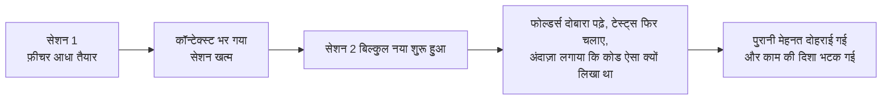
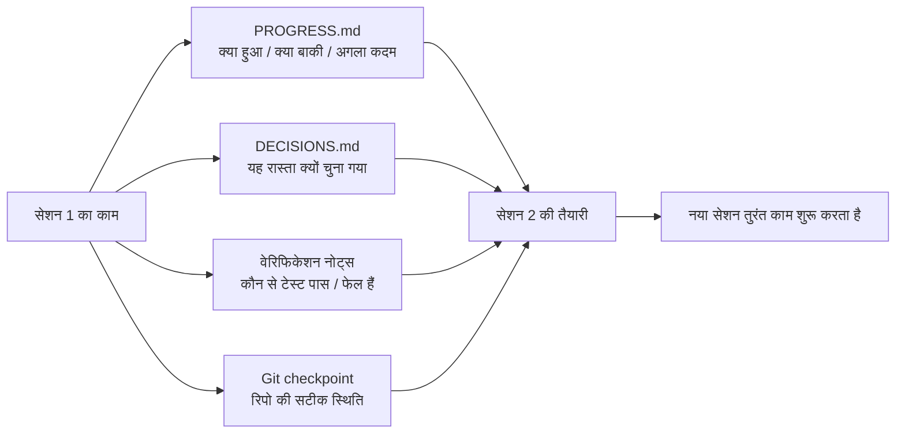

[English Version →](../../../en/lectures/lecture-05-why-long-running-tasks-lose-continuity/)

> कोड उदाहरण: [code/](https://github.com/walkinglabs/learn-harness-engineering/blob/main/docs/en/lectures/lecture-05-why-long-running-tasks-lose-continuity/code/)
> प्रैक्टिकल प्रोजेक्ट: [Project 03. मल्टी-सेशन निरंतरता](./../../projects/project-03-multi-session-continuity/index.md)

# लेक्चर 05. लंबे टास्क्स में कॉन्टेक्स्ट क्यों खो जाता है

आपने Claude Code या Cursor को एक बड़ा फ़ीचर बनाने को कहा। एजेंट 30 मिनट तक काम करता है, ज़्यादातर काम निपटा भी देता है, लेकिन अब उसकी कॉन्टेक्स्ट विंडो लगभग भर चुकी है। 

आप अगला काम जारी रखने के लिए एक नया सेशन शुरू करते हैं — और अचानक देखते हैं कि **नया एजेंट बिल्कुल अनजान बन चुका है!**
- उसे नहीं पता कि पिछले सेशन में क्या फ़ैसले लिए गए थे।
- ऑप्शन A की जगह ऑप्शन B क्यों चुना गया था?
- कौन-कौन सी फाइल्स पहले ही बदली जा चुकी हैं?
- और टेस्ट्स की अभी क्या हालत है?

नतीजा? नया सेशन 15 मिनट सिर्फ प्रोजेक्ट को दोबारा खंगालने में गँवा देता है, और मुमकिन है कि वह पिछली मेहनत के उलट कोई दूसरा ही रास्ता पकड़ ले!

यह AI कोडिंग एजेंट्स की दुनिया का सबसे कड़वा सच है: **मल्टी-सेशन टास्क्स में एजेंट की याददाश्त गायब हो जाना।** इस लेक्चर में हम समझेंगे कि लंबे टास्क्स में एजेंट्स की "कड़ी क्यों टूटती है" और स्ट्रक्चर्ड स्टेट पर्सिस्टेंस के ज़रिए नया सेशन ठीक वहीं से काम कैसे शुरू कर सकता है जहाँ पिछले वाले ने छोड़ा था।

## कॉन्टेक्स्ट विंडो कोई असीम समंदर नहीं है

कॉन्टेक्स्ट विंडो हमेशा सीमित रहेगी। यह कोई ऐसी समस्या नहीं है जो सिर्फ मॉडल बड़ा करने से सुलझ जाएगी — भले ही विंडो 10 लाख (1M) टोकन्स की हो जाए, बड़े और जटिल टास्क्स उसे भी भर देंगे। क्योंकि एजेंट सिर्फ कोड नहीं लिखता; वह पूरे कोडबेस को समझता है, अपने फ़ैसलों की हिस्ट्री रखता है, टूल्स के आउटपुट प्रोसेस करता है, और पूरी बातचीत का रिकॉर्ड सँभालता है। यह सारा डेटा विंडो के साइज़ से कहीं ज़्यादा तेज़ी से बढ़ता है।

इससे भी गहरी समस्या यह है: **एजेंट जो सोचता है, उसका हर हिस्सा एक जैसा नहीं होता।**
- बीच के प्रोसेस में **"क्यों" (Why)** छुपा होता है — जैसे हमने लाइब्रेरी X की जगह लाइब्रेरी Y क्यों चुनी?
- फाइनल आउटपुट में सिर्फ **"क्या" (What)** बचता है — यानी केवल लिखा हुआ कोड।

जब कॉन्टेक्स्ट कंपैक्ट (compact/summarize) होता है, तो कोड तो बच जाता है पर यह 'क्यों' खो जाता है। अगला सेशन कोड तो देखता है, लेकिन उसे यह नहीं पता होता कि ऐसा क्यों लिखा गया था, और वह अपनी समझदारी दिखाने के चक्कर में आपके सोचे-समझे आर्किटेक्चर को "ऑप्टिमाइज़" करके तोड़ देता है!

Anthropic ने अपने शोध में एक बहुत ही इंसानी जैसी बात पकड़ी: जब एजेंट को अहसास होता है कि उसकी कॉन्टेक्स्ट विंडो खत्म होने वाली है, तो वह हड़बड़ाहट में काम निपटाने लगता है। वह वेरिफिकेशन छोड़ देता है, और सबसे बढ़िया तरीके की जगह कोई भी चालू जुगाड़ अपना लेता है। Anthropic इसे **"Context Anxiety" (कॉन्टेक्स्ट की घबराहट)** कहता है।

## सेशन निरंतरता का फ्लो (Session Continuity Flow)

बिना स्टेट फाइल्स के, हर नया सेशन ज़ीरो से तुक्के लगाता है:



लेकिन अगर स्टेट फाइल्स मौजूद हों, तो नया सेशन पलक झपकते ही गाड़ी आगे बढ़ा देता है:



## मूल अवधारणाएँ (Core Concepts)

- **Context Windows Are Finite:** कॉन्टेक्स्ट विंडो सीमित है। इसके भरने के बाद या तो कंपैक्शन (जानकारी का संक्षिप्तीकरण) करना पड़ता है या रीसेट (नया सेशन) — और दोनों में ही कुछ न कुछ छूटने का खतरा रहता है।
- **State Persistence Files:** ऐसी फाइल्स जो पिछले सेशन की स्थिति को सुरक्षित रखती हैं, ताकि नया एजेंट बिना किसी भ्रम के काम संभाल सके।
- **Rebuild Cost (दोबारा समझने का खर्च):** एक नए सेशन को काम शुरू करने लायक स्थिति में पहुँचने में जितना समय और कॉन्टेक्स्ट खर्च होता है।
- **Drift (भटकाव):** एजेंट की समझ और कोड की असलियत के बीच का फासला। हर नया सेशन कोड को थोड़ा अलग समझता है, और बिना कंट्रोल के 3-4 सेशन्स बाद प्रोजेक्ट अपने मूल उद्देश्य से कोसों दूर भटक जाता है।
- **Context Anxiety:** कॉन्टेक्स्ट खत्म होने के डर से एजेंट का हड़बड़ी में अधूरा या घटिया काम निपटाना।

## स्टेट संभालने के 4 प्रैक्टिकल औज़ार

मूल मंत्र याद रखिए: **एजेंट को ऐसा इंजीनियर समझिए जिसकी हर शिफ्ट के बाद याददाश्त चली जाती है!** इसलिए "क्लॉक-आउट" (सेशन बंद) करने से पहले उसका यह फर्ज है कि वह अगली शिफ्ट वाले एजेंट के लिए सारी ज़रूरी बातें कागज़ पर लिखकर जाए।

### 1. प्रोग्रेस फ़ाइल (`PROGRESS.md`)
यह सबसे बुनियादी और ज़रूरी फ़ाइल है:
```markdown
# प्रोजेक्ट प्रोग्रेस (PROGRESS.md)

## मौजूदा स्थिति
- लेटेस्ट कमिट: abc1234 (feat: add user preferences endpoint)
- टेस्ट्स: 42/43 पास (test_pagination_edge_case फेल हो रहा है)
- लिंटिंग: क्लीन (कोई एरर नहीं)

## क्या काम पूरा हो चुका है?
- [x] यूज़र मॉडल और डेटाबेस माइग्रेशन
- [x] बेसिक CRUD एंडपॉइंट्स
- [x] ऑथेंटिकेशन मिडलवेयर

## अभी क्या चल रहा है?
- [ ] पेजिनेशन फ़ीचर (90% पूरा - एक एज-केस टेस्ट फेल है)

## ज्ञात समस्याएँ (Known Issues)
- खाली रिज़ल्ट्स आने पर पेजिनेशन 500 एरर दे रहा है।

## अगले कदम (Next Steps)
1. पेजिनेशन का एज-केस बग फिक्स करें।
2. "include deleted users" वाली क्वेरी सपोर्ट जोड़ें।
3. API डॉक्यूमेंटेशन अपडेट करें।
```

### 2. फ़ैसलों का रिकॉर्ड (`DECISIONS.md`)
महत्वपूर्ण तकनीकी फ़ैसलों और उनके कारणों को दर्ज करें:
```markdown
# आर्किटेक्चर फ़ैसले (DECISIONS.md)

## 2026-02-15: यूज़र प्रेफरेंस के लिए Redis कैश का चुनाव
- कारण: हर API कॉल पर रीड होता है, डेटा साइज़ बहुत छोटा है।
- जो विकल्प नकारा: PostgreSQL Materialized View (बार-बार अपडेट होने के कारण मेंटेनेंस भारी पड़ता)।
- नियम: कैश का TTL 5 मिनट रहेगा।
```

### 3. गिट कमिट्स (Git Checkpoints)
हर छोटा-मोटा काम पूरा होने और टेस्ट पास होने पर तुरंत कमिट करें। कमिट मैसेज में साफ़ लिखें कि क्या किया और क्यों किया।

### 4. `AGENTS.md` में क्लॉक-इन और क्लॉक-आउट रूटीन
एजेंट को साफ़ निर्देश दीजिए कि काम कैसे शुरू और खत्म करना है:
```markdown
## सेशन शुरू करते समय (Clock In)
1. सबसे पहले PROGRESS.md पढ़ें।
2. मुख्य फ़ैसलों के लिए DECISIONS.md देखें।
3. make check चलाकर सुनिश्चित करें कि कोई टेस्ट टूटा हुआ न हो।
4. PROGRESS.md के "Next Steps" से काम आगे बढ़ाएँ।

## सेशन खत्म करने से पहले (Clock Out)
1. PROGRESS.md को अपडेट करें।
2. make check चलाकर सब कुछ ग्रीन वेरिफाई करें।
3. पूरा काम गिट में कमिट करें।
```

## मुख्य सीख (Key Takeaways)

- कॉन्टेक्स्ट विंडो हमेशा सीमित रहेगी। मॉडल बदलने से मल्टी-सेशन की समस्या हल नहीं होती; स्ट्रक्चर्ड स्टेट फाइल्स ही इसका असली इलाज हैं।
- अगर पिछले सेशन के फ़ैसलों का 'क्यों' दर्ज नहीं है, तो अगला सेशन उसी काम को दोबारा करने या गलत तरीके से करने में वक्त गँवा देगा।
- प्रोग्रेस फ़ाइल (`PROGRESS.md`) और डिसीजन लॉग (`DECISIONS.md`) नए सेशन के रीबिल्ड कॉस्ट को लगभग शून्य कर देते हैं।
- गिट कमिट्स मुफ़्त के ऑटोमैटिक चेकपॉइंट्स हैं — हर एटॉमिक काम के बाद कमिट करने की आदत डलवाइए।

## आगे पढ़ें (Further Reading)

- [Anthropic: Effective Harnesses for Long-Running Agents](https://www.anthropic.com/engineering/effective-harnesses-for-long-running-agents)
- [Anthropic: Harness Design for Long-Running Application Development](https://www.anthropic.com/engineering/harness-design-long-running-apps)
- [OpenAI: Harness Engineering](https://openai.com/index/harness-engineering/)

## अभ्यास (Exercises)

1. **हाथ से हैंडऑफ फ़ाइल बनाएँ:** अपने मौजूदा प्रोजेक्ट के लिए एक `PROGRESS.md` तैयार कीजिए जिसमें करंट स्टेट, कम्पलीट टास्क्स और नेक्स्ट स्टेप्स लिखे हों। फिर एक बिल्कुल नया एजेंट सेशन खोलिए और देखिए कि वह कितनी तेज़ी से बिना किसी सवाल के काम पकड़ लेता है।
2. **कॉन्टेक्स्ट एंग्जायटी टेस्ट:** जब एजेंट किसी बड़े टास्क के अंत के करीब हो, तो उसके रिस्पॉन्स पर नज़र रखिए — क्या वह टेस्ट्स स्किप कर रहा है या शॉर्टकट ले रहा है? अगर हाँ, तो टास्क को छोटे-छोटे चरणों में बाँटकर रीसेट रणनीति अपनाइए।
