[English Version →](../../../en/lectures/lecture-06-why-initialization-needs-its-own-phase/)

> कोड उदाहरण: [code/](https://github.com/walkinglabs/learn-harness-engineering/blob/main/docs/hi/lectures/lecture-06-why-initialization-needs-its-own-phase/code/)
> प्रैक्टिकल प्रोजेक्ट: [Project 03. मल्टी-सेशन निरंतरता](./../../projects/project-03-multi-session-continuity/index.md)

# लेक्चर 06. इनिशियलाइज़ेशन का अलग फेज़ क्यों ज़रूरी है

आप एक नया एजेंट सेशन शुरू करते हैं और उससे कहते हैं: *"एक सर्च फ़ीचर जोड़ दो।"* एजेंट पूरे उत्साह के साथ सीधे कोडिंग में कूद पड़ता है — उसकी लगन काबिले-तारीफ़ है। लेकिन 20 मिनट बाद उसे पता चलता है कि टेस्ट फ्रेमवर्क तो ठीक से कॉन्फ़िगर ही नहीं है। अगले 10 मिनट वह उसे ठीक करने में लगाता है, फिर देखता है कि डेटाबेस माइग्रेशन स्क्रिप्ट का फॉर्मेट गलत है, फिर उसमें उलझ जाता है। अंत में सर्च फ़ीचर तो जैसे-तैसे जुड़ जाता है, लेकिन पूरा सेशन बेहद अप्रभावी साबित होता है। ज़्यादातर समय असली फ़ीचर कोड लिखने के बजाय "यह प्रोजेक्ट काम कैसे करता है" समझने में ही फूँक दिया गया।

बेहतर तरीका क्या है? एजेंट से असली काम शुरू करवाने से पहले, बेस एनवायरनमेंट को तैयार करने, वेरिफिकेशन कमांड्स चलाकर देखने, और प्रोजेक्ट स्ट्रक्चर को अच्छी तरह समझने के लिए एक **समर्पित इनिशियलाइज़ेशन फेज़ (Dedicated Initialization Phase)** चलाएँ। इनिशियलाइज़ेशन के काम को फ़ीचर इम्प्लीमेंटेशन के साथ कभी नहीं मिलाना चाहिए — ये दोनों बुनियादी रूप से दो बिल्कुल अलग तरह के काम हैं।

इस लेक्चर में हम समझेंगे कि इनिशियलाइज़ेशन को एक अलग फेज़ क्यों होना चाहिए, और इसे कोडिंग के साथ मिलाने से क्या नुकसान होता है।

## दो बिल्कुल अलग तरह के काम (Two Fundamentally Different Kinds of Work)

इनिशियलाइज़ेशन और इम्प्लीमेंटेशन के ऑप्टिमाइज़ेशन गोल्स पूरी तरह अलग होते हैं। इम्प्लीमेंटेशन फेज़ का लक्ष्य होता है: सत्यापित फीचर्स की संख्या और गुणवत्ता को अधिकतम करना। जबकि इनिशियलाइज़ेशन फेज़ का लक्ष्य होता है: इसके बाद होने वाले सभी आगामी इम्प्लीमेंटेशन सेशन्स की विश्वसनीयता और दक्षता को अधिकतम करना।

जब आप इन दोनों को मिला देते हैं, तो एजेंट एक मल्टी-ऑब्जेक्टिव समस्या में फँस जाता है: उसे एक ही समय में इन्फ्रास्ट्रक्चर भी बनाना है और फ़ीचर कोड भी लिखना है। बिना स्पष्ट प्राथमिकता के, एजेंट स्वाभाविक रूप से कोड लिखने की ओर झुक जाता है (क्योंकि वह तुरंत दिखने वाला आउटपुट है) और इन्फ्रास्ट्रक्चर की बलि चढ़ा देता है (क्योंकि उसकी असली कीमत तो अगले सेशन्स में समझ आती है)। नतीजा यह होता है कि इन्फ्रास्ट्रक्चर कभी ठोस नहीं बन पाता, और फ़ीचर कोड की विश्वसनीयता भी गिर जाती है।

## इनिशियलाइज़ेशन का लाइफसाइकिल (Initialization Lifecycle)

```mermaid
flowchart TB
    subgraph Wrong["एक ही सेशन में मिलाना (गलत तरीका)"]
        W1["तुरंत फ़ीचर कोड लिखना शुरू किया"] --> W2["बीच काम में एनवायरनमेंट और टेस्ट की कमियाँ निकलीं"]
        W2 --> W3["बिना टेस्ट किया हुआ कोड जमा होता गया"]
        W3 --> W4["अगले सेशन को फिर से ज़ीरो से प्रोजेक्ट समझना पड़ा"]
    end

    subgraph Right["समर्पित इनिशियलाइज़ेशन फेज़ (सही तरीका)"]
        R1["सेशन 1: एनवायरनमेंट पूरी तरह रनिंग है"] --> R2["कम से कम 1 उदाहरण टेस्ट पास हो रहा है"]
        R2 --> R3["Startup Readiness Checklist + टास्क लिस्ट तैयार"]
        R3 --> R4["क्लीन चेकपॉइंट गिट में कमिट"]
        R4 --> R5["अगले सेशन्स सीधे वेरिफाइड टास्क्स पर काम शुरू करते हैं"]
    end
```



## दोनों को मिलाने पर क्या नुकसान होता है? (What Happens When You Mix Them)

सबसे सीधा नुकसान: **इन्फ्रास्ट्रक्चर कभी ठोस नहीं बनता।** एजेंट अपनी अधिकांश ऊर्जा फ़ीचर कोड पर लगाता है और इन्फ्रास्ट्रक्चर को एक औपचारिकता समझता है। टेस्ट फ्रेमवर्क कॉन्फ़िगर तो होता है पर कभी टेस्ट नहीं किया जाता, लिंट रूल्स बहुत ढीले रह जाते हैं, और कोई प्रोग्रेस फ़ाइल नहीं बनती। पहले सेशन में यह कमी नहीं दिखती (क्योंकि एजेंट को याद रहता है कि उसने क्या किया), लेकिन दूसरे सेशन में पोल खुल जाती है: नए एजेंट को पता ही नहीं होता कि प्रोजेक्ट कैसे चलाएँ, कैसे टेस्ट करें, या काम कहाँ तक पहुँचा है।

एक और छुपा हुआ नुकसान है: **"बिना जाँचे हुए कोड का ढेर" (Unverified Accumulation)।** टेस्ट फ्रेमवर्क ठीक से सेट होने से पहले लिखा गया कोड — जब आप बाद में टेस्ट जोड़ने जाते हैं, तो पता चलता है कि डिज़ाइन में ही बुनियादी खामी थी। अगर यह पहले पता होता, तो आप इसे बिल्कुल अलग तरीके से बनाते।

कॉन्टेक्स्ट बजट भी बर्बाद होता है। एनवायरनमेंट सेटअप और टेस्ट कॉन्फ़िगरेशन कॉन्टेक्स्ट विंडो का एक बड़ा हिस्सा खा जाते हैं, जिससे असली फ़ीचर के लिए बहुत कम जगह बचती है। नतीजा: पहला सेशन केवल आधा काम कर पाता है, और दूसरे सेशन को फिर से नए सिरे से प्रोजेक्ट समझना पड़ता है।

सबसे खतरनाक बात है: **अनकही मान्यताओं की बारूदी सुरंगें (Implicit Assumption Landmines)।** इनिशियलाइज़ेशन के दौरान एजेंट जो निर्णय लेता है (कौन सा टेस्ट रनर, डायरेक्टरी का ढाँचा, डिपेंडेंसी मैनेजमेंट) — यदि उन्हें फाइल्स में दर्ज न किया जाए, तो अगला एजेंट विरोधाभासी फैसले ले सकता है। पहले सेशन ने Vitest चुना, दूसरे सेशन के एजेंट ने अनजान बनकर Jest जोड़ दिया — दो-दो टेस्ट फ्रेमवर्क खड़े हो गए और मेंटेनेंस की लागत दोगुनी हो गई!

Anthropic अपने लंबे समय तक चलने वाले एजेंट्स में [इनिशियलाइज़ेशन को एक समर्पित पहला सेशन बनाती है](https://www.anthropic.com/engineering/effective-harnesses-for-long-running-agents)। इनिशियलाइज़र एजेंट एक `init.sh` स्क्रिप्ट, प्रोग्रेस फ़ाइल, फ़ीचर लिस्ट, और शुरुआती गिट कमिट तैयार करता है; बाद के कोडिंग सेशन्स उसी स्टेट को पढ़कर एक बार में एक फ़ीचर पर काम करते हैं।

OpenAI का Codex हार्नेस इंजीनियरिंग गाइड भी "रिपॉजिटरी ही एकमात्र सच है" सिद्धांत पर ज़ोर देता है: पहले ही रन से एक स्पष्ट ढाँचा तैयार करें, वरना हर नया सेशन प्रोजेक्ट के नियमों का अंदाज़ा ही लगाता रह जाएगा।

## मूल अवधारणाएँ (Core Concepts)

- **इनिशियलाइज़ेशन फेज़ (Initialization Phase)**: एजेंट के जीवनचक्र का पहला चरण — यह केवल बाद के विकास के लिए पूर्व-शर्तें स्थापित करता है, कोई बिज़नेस फ़ीचर कोड नहीं लिखता। इसका आउटपुट इन्फ्रास्ट्रक्चर होता है, कोड नहीं।
- **स्टार्टअप रेडीनेस चेकलिस्ट (Startup Readiness Checklist)**: वे 4 अनिवार्य शर्तें जिनके पूरा होने पर ही कोई नया एजेंट सेशन प्रोजेक्ट को बिना किसी भ्रम के चला सकता है: स्टार्ट हो सके, टेस्ट चल सके, प्रोग्रेस दिख सके, और अगला काम साफ़ हो।
- **शुरुआत से बनाम टेम्पलेट से (From Scratch vs From Template)**: खाली डायरेक्टरी से शुरुआत करने पर एजेंट को सब कुछ खुद अंदाज़ा लगाना पड़ता है; टेम्पलेट से शुरू करने पर इन्फ्रास्ट्रक्चर पहले से तैयार मिलता है। टेम्पलेट से शुरू करना हमेशा बेहतर रिज़ल्ट देता है।
- **हमेशा हैंडऑफ के लिए तैयार (Always Ready to Hand Off)**: प्रोजेक्ट हर समय ऐसी स्थिति में रहे कि कोई नया एजेंट आकर तुरंत काम संभाल सके। किसी मौखिक स्पष्टीकरण की ज़रूरत न हो — सिर्फ रिपो देखकर काम जारी रखा जा सके।
- **स्टार्ट से पहले पासिंग टेस्ट तक का समय (Time from Start to First Passing Test)**: प्रोजेक्ट शुरू होने से लेकर पहले फ़ीचर के टेस्ट पास होने तक का समय। यह इनिशियलाइज़ेशन की दक्षता मापने का मुख्य पैमाना है।
- **आगामी सेशन्स की सफलता दर (Success Rate of Subsequent Sessions)**: बाद के सेशन्स का वह अनुपात जो बिना किसी छिपे हुए ज्ञान के अपने टास्क्स सफलतापूर्वक पूरे कर लेते हैं।

## इनिशियलाइज़ेशन सही तरीके से कैसे करें? (How to Do Initialization Right)

**इनिशियलाइज़ेशन को एक समर्पित फेज़ मानें।** पहला सेशन केवल इनिशियलाइज़ेशन करेगा — बिज़नेस कोड की एक भी लाइन नहीं लिखेगा। इस फेज़ का आउटपुट होगा:

**1. चलने योग्य एनवायरनमेंट (Runnable environment):** प्रोजेक्ट स्टार्ट हो, डिपेंडेंसीज़ इंस्टॉल हों, कोई एनवायरनमेंट एरर न हो।

**2. सत्यापित टेस्ट फ्रेमवर्क (Verifiable test framework):** कम से कम एक उदाहरण टेस्ट पास हो रहा हो, जो साबित करे कि टेस्ट फ्रेमवर्क ठीक से कॉन्फ़िगर है।

**3. स्टार्टअप रेडीनेस चेकलिस्ट दस्तावेज़:** एक स्पष्ट दस्तावेज़ जो अगले सेशन्स को बताए:
```markdown
# Startup Readiness Checklist

## Start Commands
- डिपेंडेंसीज़ इंस्टॉल करें: `make setup`
- डेव सर्वर चलाएँ: `make dev`
- टेस्ट्स चलाएँ: `make test`
- पूरा वेरिफिकेशन: `make check`

## Current State
- सभी डिपेंडेंसीज़ इंस्टॉल और लॉक्ड हैं
- टेस्ट फ्रेमवर्क कॉन्फ़िगर है (Vitest + React Testing Library)
- उदाहरण टेस्ट पास हो रहा है (1/1)
- लिंट रूल्स सेट हैं (ESLint + Prettier)

## Project Structure
- src/ — सोर्स कोड
- src/components/ — React कंपोनेंट्स
- src/api/ — API क्लाइंट
- tests/ — टेस्ट फाइल्स
```

**4. टास्क ब्रेकडाउन (Task breakdown):** पूरे प्रोजेक्ट को एक व्यवस्थित टास्क लिस्ट में तोड़ें, हर टास्क के स्पष्ट एक्सेप्टेंस क्राइटेरिया हों:
```markdown
# Task Breakdown

## Task 1: User Authentication Basics
- JWT auth मिडलवेयर लागू करें
- लॉगिन/रजिस्टर एंडपॉइंट्स जोड़ें
- स्वीकृति: pytest tests/test_auth.py के सभी टेस्ट पास हों

## Task 2: User Profile Page
- यूज़र प्रोफाइल CRUD लागू करें
- प्रोफाइल एडिट फॉर्म जोड़ें
- स्वीकृति: pytest tests/test_profile.py पास हो
```

**5. गिट कमिट को चेकपॉइंट बनाएँ:** इनिशियलाइज़ेशन पूरा होने के बाद एक साफ़ चेकपॉइंट कमिट करें। बाकी सारा काम इसी चेकपॉइंट से शुरू होगा।

**टेम्पलेट से शुरुआत करें**: खाली डायरेक्टरी से शुरुआत मत कीजिए। प्रोजेक्ट टेम्पलेट (create-react-app, fastapi-template आदि) का इस्तेमाल करें ताकि बुनियादी ढाँचा पहले से मौजूद हो।

**इनिशियलाइज़ेशन पूरा होने का पैमाना**: यह नहीं कि "कितना कोड लिखा गया," बल्कि यह कि क्या स्टार्टअप रेडीनेस चेकलिस्ट की चारों शर्तें पूरी हो गई हैं:

```markdown
## Initialization Acceptance Checklist
- [ ] `make setup` शुरुआत से सफलतापूर्वक चलता है
- [ ] `make test` में कम से कम एक टेस्ट पास होता है
- [ ] एक नया एजेंट सेशन केवल रिपो देखकर "कैसे चलाएँ" और "कैसे टेस्ट करें" समझ सकता है
- [ ] कम से कम 3 स्पष्ट टास्क्स वाली टास्क ब्रेकडाउन फ़ाइल मौजूद है
- [ ] सब कुछ गिट में साफ-सुथरा कमिटेड है
```

## वास्तविक उदाहरण (Real-World Example)

React फ्रंटेंड प्रोजेक्ट के लिए इनिशियलाइज़ेशन के दो तरीकों की तुलना:

**मिश्रित दृष्टिकोण (Mixed approach)**: एजेंट ने सेशन 1 में प्रोजेक्ट स्कैफोल्डिंग भी बनाई और पहला फ़ीचर भी लागू किया। सेशन के अंत में कोड तो था लेकिन कोई स्पष्ट रन/टेस्ट कमांड डॉक्यूमेंटेशन नहीं था, कोई प्रोग्रेस ट्रैकिंग नहीं थी। सेशन 2 को केवल प्रोजेक्ट ढाँचा और टेस्ट रनर समझने में 20 मिनट गँवाने पड़े।

**समर्पित इनिशियलाइज़ेशन (Dedicated initialization)**: सेशन 1 ने केवल इनिशियलाइज़ेशन किया — टेम्पलेट से स्ट्रक्चर बनाया, Vitest टेस्ट फ्रेमवर्क सेट किया, एक उदाहरण टेस्ट पास किया, और स्टार्टअप रेडीनेस चेकलिस्ट कमिट की। सेशन 2 का रीबिल्ड समय 3 मिनट से भी कम था, और उसने सीधे टास्क लिस्ट से काम शुरू कर दिया।

पूरे प्रोजेक्ट चक्र में: मिश्रित दृष्टिकोण का कुल रीबिल्ड समय समर्पित दृष्टिकोण की तुलना में 60% ज़्यादा था। इनिशियलाइज़ेशन में लगाए गए अतिरिक्त 20 मिनट अगले सेशन्स में कई गुना बनकर वापस लौट आए।

## मुख्य सीख (Key Takeaways)

- इनिशियलाइज़ेशन और इम्प्लीमेंटेशन के लक्ष्य अलग होते हैं — दोनों को मिलाने से दोनों का स्तर गिरता है।
- इनिशियलाइज़ेशन का आउटपुट बिज़नेस कोड नहीं, बल्कि इन्फ्रास्ट्रक्चर है: रनिंग एनवायरनमेंट, टेस्ट फ्रेमवर्क, स्टार्टअप चेकलिस्ट, और टास्क ब्रेकडाउन।
- चार शर्तों से इनिशियलाइज़ेशन की जाँच करें: स्टार्ट हो सके, टेस्ट चल सके, प्रोग्रेस दिखे, और अगला काम साफ़ हो।
- खाली जगह से शुरू करने के बजाय प्रोजेक्ट टेम्पलेट से शुरुआत करें।
- इनिशियलाइज़ेशन में लगाया गया समय अगले 3-4 सेशन्स में पूरी तरह वसूल हो जाता है।

## आगे पढ़ें (Further Reading)

- [Anthropic: Effective Harnesses for Long-Running Agents](https://www.anthropic.com/engineering/effective-harnesses-for-long-running-agents)
- [OpenAI: Harness Engineering](https://openai.com/index/harness-engineering/)
- [HumanLayer: Harness Engineering for Coding Agents](https://www.humanlayer.dev/blog/skill-issue-harness-engineering-for-coding-agents)
- [Infrastructure as Code — Martin Fowler](https://martinfowler.com/bliki/InfrastructureAsCode.html)

## अभ्यास (Exercises)

1. **स्टार्टअप रेडीनेस चेकलिस्ट डिज़ाइन करें**: अपने वर्तमान प्रोजेक्ट के लिए एक स्टार्टअप चेकलिस्ट लिखें। फिर एक नया एजेंट सेशन शुरू करके उसे केवल रिपो देखने दें। देखें कि वह कहाँ अटकता है — हर अड़चन आपकी चेकलिस्ट में छूटी हुई एक शर्त है।
2. **तुलनात्मक प्रयोग**: एक नए प्रोजेक्ट में दो अप्रोच आज़माएँ: अप्रोच A (दोनों एक साथ) और अप्रोच B (अलग इनिशियलाइज़ेशन)। 4 सेशन्स बाद कुल समय और एरर रेट की तुलना करें।
3. **एक्सेप्टेंस चेकलिस्ट निष्पादित करें**: अपने प्रोजेक्ट के लिए एक्सेप्टेंस चेकलिस्ट बनाएँ और एजेंट से उसके हर आइटम को वेरिफाई करवाएँ।
