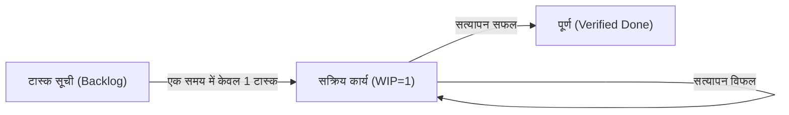

[English Version →](../../../en/lectures/lecture-07-why-agents-overreach-and-under-finish/)

> कोड उदाहरण: [code/](https://github.com/walkinglabs/learn-harness-engineering/blob/main/docs/hi/lectures/lecture-07-why-agents-overreach-and-under-finish/code/)
> प्रैक्टिकल प्रोजेक्ट: [Project 04. रनटाइम फीडबैक और स्कोप कंट्रोल](./../../projects/project-04-incremental-indexing/index.md)

# लेक्चर 07. एजेंट्स काम अधूरा क्यों छोड़ते हैं

आपने एजेंट से कहा: *"यूज़र रजिस्ट्रेशन फ़ीचर बना दो।"* एजेंट काम में जुटता है और 20 मिनट बाद 12 फाइलों में 800 लाइनों का कोड फैला देता है। आप कोड खोलते हैं तो देखते हैं: यूज़र रजिस्ट्रेशन तो आधा-अधूरा बना ही है, साथ में उसने डेटाबेस स्कीमा को भी "सुधारने" की कोशिश की, पासवर्ड रीसेट की आधी अधूरी सर्विस जोड़ दी, और लॉगिंग मिडलवेयर को भी बिना पूछे बदल डाला। लेकिन जब आप `npm test` चलाते हैं, तो पता चलता है कि एक भी फ़ीचर एंड-टू-एंड पास नहीं हो रहा!

एजेंट्स के साथ यह रोज़ की कहानी है। इसे हम दो जुड़े हुए सिंड्रोम्स कहते हैं: **ओवररीच (Overreach - ज़रूरत से ज़्यादा हाथ-पैर मारना)** और **अंडर-फिनिश (Under-finish - किसी भी काम को पूरा न करना)**।

## ध्यान (Attention) एक सीमित संसाधन है

एजेंट्स असीम नहीं हैं। उनकी कॉन्टेक्स्ट विंडो और अटेंशन कैपेसिटी एक सीमित संसाधन है। जब कोई एजेंट एक ही समय में तीन-चार काम हाथ में ले लेता है, तो उसका ध्यान बँट जाता है। वह कोड जनरेट तो धड़ाधड़ करता है, लेकिन किसी भी फ़ीचर के एज-केसेस, एरर-हैंडलिंग, या वेरिफिकेशन को पूरा नहीं करता।

जब तक आप हार्नेस के स्तर पर कड़े नियम नहीं लगाएँगे, एजेंट हमेशा अपनी मर्ज़ी से काम का दायरा बढ़ाता रहेगा।

## WIP=1 वर्कफ़्लो (एक बार में सिर्फ एक काम)

कैनबन (Kanban) का सबसे बुनियादी नियम है: **WIP (Work In Progress) = 1**। एजेंट हार्नेस में यह सोने का नियम है।



- जब तक सक्रिय फ़ीचर का वेरिफिकेशन पास न हो जाए, तब तक एजेंट किसी नए फ़ीचर को हाथ नहीं लगा सकता।
- "लगे हाथ यह भी सुधार दूँ" की प्रवृत्ति पर पूरी तरह रोक होनी चाहिए।

## मूल अवधारणाएँ (Core Concepts)

- **ओवररीच (Overreach)**: जब एजेंट अपने दिए गए टास्क के दायरे से बाहर जाकर दूसरे कंपोनेंट्स या आर्किटेक्चर को बदलने लगता है।
- **अंडर-फिनिश (Under-finish)**: कोड लिख देना लेकिन उसके काम करने का कोई ठोस सबूत (Passing Tests) न देना।
- **सत्यापित पूर्णता दर (Verified Completion Rate - VCR)**: सत्यापित टास्क्स / सक्रिय टास्क्स का अनुपात। हार्नेस को यह सुनिश्चित करना चाहिए कि VCR हमेशा 1.0 रहे।
- **स्कोप सर्फेस (Scope Surface)**: वे फाइल्स और फंक्शन्स जिन्हें बदलने की अनुमति एजेंट को इस विशिष्ट टास्क के लिए दी गई है।

## इसे सही तरीके से कैसे लागू करें? (How to Implement Right)

### 1. कड़ा WIP=1 नियम बनाएँ
`AGENTS.md` में साफ़ लिखें:
```markdown
## Scope Rules
- एक समय में केवल एक फ़ीचर पर काम करें (WIP=1)
- फ़ीचर A बनाते समय फ़ीचर B का रिफैक्टरिंग बिल्कुल न करें
- जब तक वर्तमान फ़ीचर का टेस्ट पास न हो, नया फ़ीचर शुरू न करें
```

### 2. हर टास्क के लिए स्पष्ट कंप्लीशन एविडेंस (Completion Evidence) तय करें
काम पूरा होने का मतलब यह नहीं कि "कोड लिख दिया गया है" — बल्कि यह है कि "सत्यापन कमांड 100% पास हो रहा है":
```
F01: User Registration
  Verification: curl -X POST /api/register -d '{"email":"test@example.com","password":"123"}' | jq .status == 201
  State: passing
```

### 3. स्कोप सर्फेस को एक फ़ाइल में बाहर निकालें
मशीन-पठनीय फ़ाइल (`feature_list.json` या `progress.md`) में स्थिति दर्ज करें ताकि कोई भी नया सेशन तुरंत समझ सके कि कौन सा टास्क एक्टिव है।

### 4. VCR की निगरानी करें
जब तक पुराना टास्क वेरिफाइड न हो, नए टास्क का एक्टिवेशन ब्लॉक रखें।

## वास्तविक केस स्टडी (Real-World Case)

8 फीचर्स वाले एक REST API प्रोजेक्ट में दो रणनीतियों की तुलना:

**बिना नियंत्रण वाला मोड (Unconstrained)**: एजेंट ने सेशन 1 में एक साथ 5 फीचर्स छुए। 12 फाइल्स में 800 लाइन्स कोड लिखा। एंड-टू-एंड टेस्ट पास रेट: केवल 20% (सिर्फ यूज़र रजिस्ट्रेशन काम कर रहा था)। सेशन 3 के अंत तक 8 में से केवल 3 फीचर्स पूरे हुए।

**WIP=1 मोड**: एजेंट ने सेशन 1 में केवल यूज़र रजिस्ट्रेशन पर काम किया। 4 फाइलों में 200 लाइन्स कोड लिखा। टेस्ट 100% पास। सेशन 4 के अंत तक 8 में से 7 फीचर्स पूरी तरह वेरिफाइड और तैयार थे।

नतीजा: कुल कोड कम (WIP=1 मोड में 4 सेशन्स में लगभग 800 लाइन्स, बनाम बिना सीमा वाले मोड में 3 सेशन्स में लगभग 1200 लाइन्स), लेकिन अधिक उपयोगी कोड। पूर्णता दर: 87.5% (WIP=1) बनाम 37.5% (बिना सीमा वाला मोड)।

## मुख्य सीख (Key Takeaways)

- **WIP=1 एजेंट हार्नेस का डिफ़ॉल्ट सुरक्षित नियम है** — एक पूरा करो, फिर अगला शुरू करो।
- **काम पूरा होने का सबूत एक्ज़ीक्यूटेबल होना चाहिए** — "कोड ठीक लग रहा है" नहीं चलेगा, "टेस्ट पास हो रहा है" चाहिए।
- **स्कोप को फाइल्स में दर्ज करें** — केवल बातों में नहीं, बल्कि रिपो में मशीन-पठनीय फ़ाइल में।
- **ओवररीच और अंडर-फिनिश एक-दूसरे के साथी हैं** — एक को रोकोगे तो दूसरा अपने-आप रुक जाएगा।
- **"कम करो पर पूरा करो" हमेशा "ज़्यादा करो पर अधूरा छोड़ो" से बेहतर होता है।**

## आगे पढ़ें (Further Reading)

- [Anthropic: Effective Harnesses for Long-Running Agents](https://www.anthropic.com/engineering/effective-harnesses-for-long-running-agents)
- [OpenAI: Harness Engineering](https://openai.com/index/harness-engineering/)
- [Kanban: Successful Evolutionary Change - David Anderson](https://www.goodreads.com/book/show/1070822.Kanban)

## अभ्यास (Exercises)

1. **टास्क अटॉमाइजेशन**: एक बड़ी आवश्यकता (जैसे "यूज़र मैनेजमेंट सिस्टम") को 5 छोटे अटॉमिक टास्क्स में तोड़ें। हर टास्क के लिए स्पष्ट वेरिफिकेशन कमांड लिखें।
2. **तुलनात्मक प्रयोग**: एक प्रोजेक्ट को दो बार चलाएँ — एक बार बिना WIP लिमिट के, और एक बार सख्त WIP=1 के साथ। पूर्णता दर की तुलना करें।
3. **कंप्लीशन एविडेंस ऑडिट**: अपने पिछले एजेंट रन का ऑडिट करें और देखें कि कितने कोड बदलावों के पीछे ठोस वेरिफिकेशन मौजूद था।
