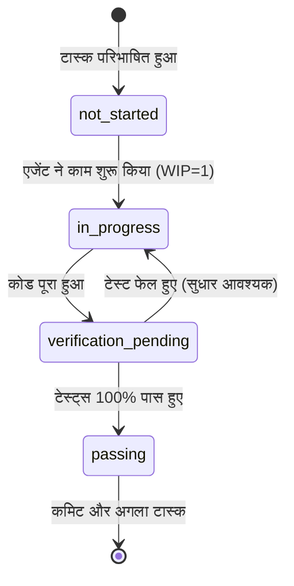

[English Version →](../../../en/lectures/lecture-08-why-feature-lists-are-harness-primitives/)

> कोड उदाहरण: [code/](https://github.com/walkinglabs/learn-harness-engineering/blob/main/docs/hi/lectures/lecture-08-why-feature-lists-are-harness-primitives/code/)
> प्रैक्टिकल प्रोजेक्ट: [Project 04. रनटाइम फीडबैक और स्कोप कंट्रोल](./../../projects/project-04-incremental-indexing/index.md)

# लेक्चर 08. फ़ीचर लिस्ट हार्नेस का मूल आधार क्यों है

इंसान जब किसी प्रोजेक्ट पर काम करते हैं, तो उनके दिमाग में एक समझ होती है कि "यह काम कब पूरा माना जाएगा।" लेकिन AI एजेंट्स के पास ऐसा कोई सहज ज्ञान नहीं होता। जब तक आप उनके सामने एक सख्त, मशीन-पठनीय फ़ीचर लिस्ट नहीं रखेंगे, एजेंट या तो काम अधूरा छोड़ देगा या फिर अनावश्यक चीज़ें जोड़ता चला जाएगा।

इस लेक्चर में हम सीखेंगे कि **फ़ीचर लिस्ट्स (Feature Lists)** केवल इंसानों के पढ़ने के लिए बने नोट्स नहीं हैं, बल्कि वे एजेंट हार्नेस का सबसे बुनियादी निर्माण खंड (Primitive) हैं।

## एजेंट्स को नहीं पता कि "Done" क्या होता है

अगर आप किसी एजेंट से कहें: *"शॉपिंग कार्ट बना दो,"* तो उसके पास यह जानने का कोई ज़रिया नहीं है कि उसमें डिस्काउंट कूपन शामिल हैं या नहीं, टैक्स कैलकुलेशन होना चाहिए या नहीं, या गेस्ट चेकआउट सपोर्ट करना है या नहीं। 

नतीजा यह होता है कि एजेंट अपनी मर्ज़ी से दायरा तय करता है। जब टोकन बजट कम होने लगता है, तो वह किसी भी स्थिति में काम पूरा होने का ऐलान कर देता है। फ़ीचर लिस्ट इस अनिश्चितता को खत्म करती है।

## फ़ीचर स्टेट मशीन (Feature State Machine)

हार्नेस में हर फ़ीचर एक स्पष्ट स्टेट मशीन से गुज़रता है:



## मूल अवधारणाएँ (Core Concepts)

- **ट्रिपल स्ट्रक्चर (The Triple Structure)**: हर फ़ीचर एंट्री में तीन अनिवार्य घटक होने चाहिए:
  1. **Behavior**: फ़ीचर का स्पष्ट और सटीक व्यवहार।
  2. **Verification Command**: स्वचालित कमांड जो इस व्यवहार को जाँचे।
  3. **State**: वर्तमान स्थिति (`not-started`, `in-progress`, `passing`)।
- **पास-स्टेट गेटिंग (Pass-State Gating)**: एजेंट खुद किसी फ़ीचर को `passing` मार्क नहीं कर सकता। केवल हार्नेस टेस्ट चलाकर स्थिति बदल सकता है।
- **एकल सत्य स्रोत (Single Source of Truth)**: प्रोजेक्ट में क्या बना और क्या बाकी है, इसका एकमात्र आधिकारिक दस्तावेज़ फ़ीचर लिस्ट ही है।

## इसे कोड में कैसे लागू करें? (How to Implement)

### 1. स्ट्रक्चर्ड `feature_list.json`
```json
{
  "id": "F03",
  "behavior": "POST /cart/items with {product_id, quantity} returns 201",
  "verification": "npm test tests/cart.test.ts",
  "state": "passing",
  "evidence": "commit abc123, 4/4 tests passed"
}
```

### 2. हार्नेस को स्टेट ट्रांज़िशन नियंत्रित करने दें
एजेंट केवल वेरिफिकेशन का अनुरोध कर सकता है। हार्नेस कमांड चलाएगा और आउटपुट देखकर स्टेट अपडेट करेगा।

### 3. नियमों को `CLAUDE.md` या `AGENTS.md` में लिखें
```markdown
## Feature List Rules
- फ़ीचर लिस्ट फ़ाइल: `feature_list.json`
- एक समय में केवल एक फ़ीचर एक्टिव रखें
- स्टेट बदलने का अधिकार केवल टेस्ट रनर के पास है
```

### 4. सही ग्रैन्युलैरिटी (Granularity) चुनें
हर टास्क ऐसा होना चाहिए जो "एक सेशन में पूरा हो सके।" "शॉपिंग कार्ट बनाओ" बहुत बड़ा है; "कार्ट मॉडल में नेम फ़ील्ड जोड़ो" बहुत छोटा है; "यूज़र कार्ट में आइटम जोड़ सके और 201 मिले" एकदम सही है।

## वास्तविक केस स्टडी (Real-World Case)

10 फीचर्स वाले एक ई-कॉमर्स प्रोजेक्ट में दो तरीकों की तुलना:

**मेमो मोड**: एजेंट अनस्ट्रक्चर्ड नोट्स का उपयोग करता है। 3 सेशन्स के बाद नोट्स अस्पष्ट हो जाते हैं: *"कार्ट आधा हुआ, कुछ बग्स हैं, पेमेंट बाकी है।"* नया एजेंट स्थिति समझने में 20 मिनट गँवाता है और पहले से बने फीचर्स को दोबारा लिख देता है।

**स्ट्रक्चर्ड मोड**: हर फ़ीचर की स्थिति और टेस्ट कमांड `feature_list.json` में दर्ज है। नया एजेंट 3 मिनट में समझ जाता है कि F01-F05 पास हैं, F06 पर काम चल रहा है, और F07-F10 अभी शुरू नहीं हुए। कोई दोहराव नहीं, शून्य बर्बादी।

## मुख्य सीख (Key Takeaways)

- **फ़ीचर लिस्ट हार्नेस का मूल ढाँचा है**, इंसानों के लिए मेमो नहीं।
- **हर फ़ीचर में ट्रिपल होना अनिवार्य है**: व्यवहार विवरण + सत्यापन कमांड + वर्तमान स्थिति।
- **स्टेट ट्रांज़िशन पर हार्नेस का पहरा होना चाहिए** — एजेंट अपनी मर्ज़ी से खुद को पास घोषित नहीं कर सकता।
- **टास्क का आकार ऐसा रखें जो एक सेशन में पूरा हो सके।**

## आगे पढ़ें (Further Reading)

- [Anthropic: Building Effective Agents](https://www.anthropic.com/research/building-effective-agents)
- [OpenAI: Harness Engineering](https://openai.com/index/harness-engineering/)
- [Design by Contract — Bertrand Meyer](https://www.goodreads.com/book/show/130439.Object_Oriented_Software_Construction)

## अभ्यास (Exercises)

1. **फ़ीचर लिस्ट स्कीमा डिज़ाइन करें**: अपने प्रोजेक्ट के 5 फीचर्स के लिए JSON फ़ीचर लिस्ट तैयार करें जिसमें आईडी, व्यवहार, टेस्ट कमांड और स्थिति शामिल हो।
2. **सत्यापन की सख्ती की तुलना**: 3 फीचर्स के लिए एक ढीला टेस्ट और एक सख्त E2E टेस्ट डिज़ाइन करें। दोनों के परिणामों की तुलना करें।
3. **सिंगल सोर्स ऑडिट**: अपनी वर्तमान रिपॉजिटरी की जाँच करें और देखें कि क्या कोई अनकही आवश्यकता फ़ीचर लिस्ट से बाहर तो नहीं रह गई।
