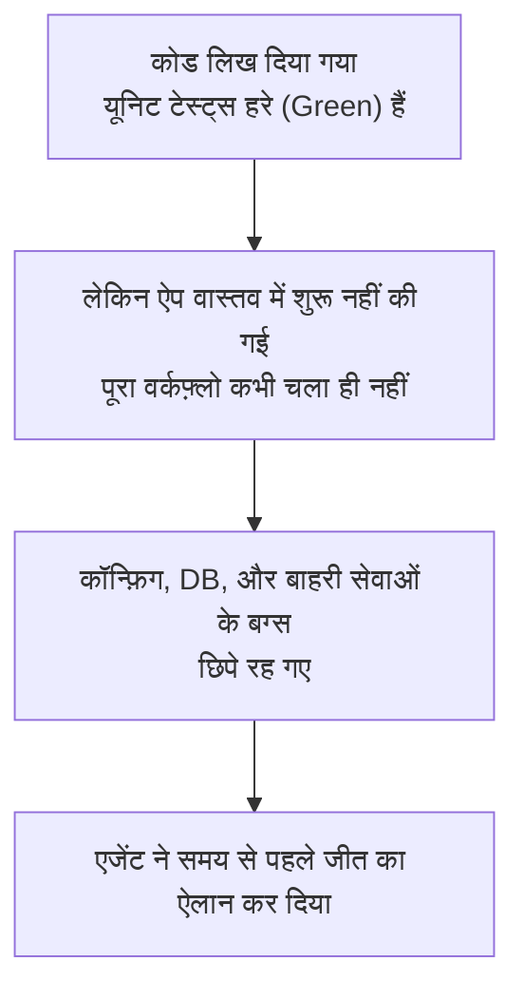

[English Version →](../../../en/lectures/lecture-09-why-agents-declare-victory-too-early/)

> कोड उदाहरण: [code/](https://github.com/walkinglabs/learn-harness-engineering/blob/main/docs/hi/lectures/lecture-09-why-agents-declare-victory-too-early/code/)
> प्रैक्टिकल प्रोजेक्ट: [Project 05. सेल्फ-वेरिफिकेशन और रोल सेपरेशन](./../../projects/project-05-grounded-qa-verification/index.md)

# लेक्चर 09. एजेंट्स समय से पहले जीत का ऐलान क्यों करते हैं

AI कोडिंग एजेंट्स के साथ काम करते समय सबसे आम और सबसे निराशाजनक अनुभव यह होता है: एजेंट 15 मिनट काम करता है, फिर गर्व से कहता है — *"बॉस, काम पूरा हो गया! सब कुछ परफेक्ट काम कर रहा है!"* लेकिन जब आप ऐप खोलते हैं, तो वह स्टार्ट ही नहीं होती, या पहला बटन दबाते ही क्रैश हो जाती है।

इसे हम **समय से पहले जीत का ऐलान (Premature Completion Declaration)** कहते हैं। एजेंट के आत्मविश्वास और असलियत के बीच की इस खाई को पाटना हार्नेस इंजीनियरिंग का सबसे बड़ा काम है।

## फिसलन भरा रास्ता (The Slippery Slope)

एजेंट इस जाल में कैसे फँसता है?



## मूल अवधारणाएँ (Core Concepts)

- **समय से पहले समाप्ति (Premature Completion Declaration)**: जब एजेंट दावा करता है कि काम पूरा हो गया, जबकि सिस्टम-स्तरीय आवश्यकताएँ अभी भी अधूरी हैं।
- **कॉन्फिडेंस कैलिब्रेशन बायस (Confidence Calibration Bias)**: एजेंट के अपने काम पर आत्मविश्वास और काम की वास्तविक गुणवत्ता के बीच एक व्यवस्थित अंतर होता है। एजेंट हमेशा अपनी असल क्षमता से कहीं ज़्यादा आत्मविश्वासी होता है।
- **टर्मिनेशन क्राइटेरिया (Termination Criteria)**: हार्नेस में परिभाषित स्पष्ट, एक्ज़ीक्यूटेबल शर्तें जिन्हें पूरा किए बिना एजेंट काम पूरा नहीं मान सकता। "Done" एक व्यक्तिपरक राय नहीं, एक वस्तुनिष्ठ जाँच है।
- **वेरिफिकेशन और वैलिडेशन डुअल गेट**: पहली परत (Verification) कोड के सिंटैक्स और यूनिट्स को जाँचती है; दूसरी परत (Validation) पूरे सिस्टम के एंड-टू-एंड व्यवहार को जाँचती है।
- **रनटाइम सिग्नल्स**: लॉग्स, प्रोसेस स्टेटस, और हेल्थ चेक्स — ये हार्नेस के वस्तुनिष्ठ प्रमाण हैं।

## यूनिट टेस्ट पास होना ≠ काम पूरा होना

यह सबसे आम और खतरनाक जाल है। यूनिट टेस्ट्स का डिज़ाइन ही ऐसा होता है कि वे डिपेंडेंसीज़ को मॉक (mock) कर देते हैं। इससे कई गंभीर खामियाँ छिप जाती हैं:

- **इंटरफ़ेस मिसमैच**: रेंडरर रिलेटिव पाथ भेज रहा है जबकि प्रीलोड स्क्रिप्ट एब्सोल्यूट पाथ चाहती है। दोनों के यूनिट टेस्ट्स पास हो जाते हैं, लेकिन असल ऐप में दोनों कनेक्ट नहीं होते!
- **स्टेट प्रोपेगेशन एरर्स**: डेटाबेस स्कीमा बदल गया पर ORM कैश पुरानी स्कीमा लिए बैठा है। यूनिट टेस्ट्स हर बार फ्रेश मॉक में चलते हैं, इसलिए यह बग कभी पकड़ में नहीं आता।
- **पर्यावरण निर्भरता**: कोड टेस्ट एनवायरनमेंट में सही चलता है पर असली एनवायरनमेंट में मिसिंग कॉन्फ़िगरेशन या लेटेंसी के कारण फेल हो जाता है।

### "लगे हाथ रिफैक्टरिंग करना" कंप्लीशन के लिए ज़हर है
एजेंट्स में एक आदत होती है: कोर फ़ीचर टेस्ट होने से पहले ही वे कोड को चमकाने, रिफैक्टर करने और स्टाइल सुधारने में लग जाते हैं। इससे वेरिफाइड और अन-वेरिफाइड कोड की सीमा टूट जाती है।

### सेल्फ-इवैल्यूएशन में व्यवस्थित पूर्वाग्रह (Systematic Bias)
Anthropic की 2026 की रिसर्च से पता चला: **जब किसी एजेंट से उसका खुद का काम जाँचने को कहा जाता है, तो वह हमेशा खुद को ज़रूरत से ज़्यादा सकारात्मक रेटिंग देता है — यहाँ तक कि जब काम साफ़ तौर पर घटिया हो!**

समाधान एजेंट को "ज़्यादा निष्पक्ष" बनाना नहीं है, बल्कि **काम करने वाले (Maker) और जाँचने वाले (Checker) को अलग करना है**।

Anthropic का प्रायोगिक डेटा:

| आर्किटेक्चर | रनटाइम | लागत | क्या कोर फीचर्स चले? |
|---|---|---|---|
| सिंगल एजेंट (बिना हार्नेस) | 20 मिनट | $9 | नहीं (इनपुट पर कोई रिस्पॉन्स नहीं) |
| 3 एजेंट्स (प्लानर + मेकर + चेकर) | 6 घंटे | $200 | हाँ, कोर गेमप्ले चला; सिर्फ लेवल्स अधूरे रहे |

## इसे रोकने के 4 सुनहरे नियम (How to Prevent Premature Declarations)

### 1. टर्मिनेशन का फैसला हार्नेस के हाथ में दें
`AGENTS.md` में "Definition of Done" साफ़ लिखें:
```markdown
## Definition of Done
- काम पूरा = एंड-टू-एंड वेरिफिकेशन पास हुआ, न कि "कोड लिख दिया गया"
- आवश्यक स्तर:
  1. यूनिट टेस्ट पास हों
  2. इंटीग्रेशन टेस्ट पास हों
  3. पूरा E2E फ्लो पास हो
```

### 2. तीन-परत वाली टर्मिनेशन जाँच (Three-Layer Termination Check)
1. **Layer 1: सिंटैक्स और स्टैटिक एनालिसिस**: टाइपचेक और लिंटिंग।
2. **Layer 2: रनटाइम व्यवहार सत्यापन**: टेस्ट्स निष्पादन और प्रोसेस स्टार्टअप।
3. **Layer 3: सिस्टम-स्तरीय पुष्टि**: एंड-टू-एंड प्लेराइट या यूजर-फ्लो सिमुलेशन।

### 3. एजेंट को कार्रवाई-योग्य (Actionable) एरर फीडबैक दें
सिर्फ "एरर आया" मत कहिए, बल्कि बताइए कि उसे ठीक कैसे करना है।

### 4. रनटाइम सिग्नल्स को कैप्चर करें
लॉग्स और एग्ज़िट कोड्स से ही कंप्लीशन का निर्णय लें।

## वास्तविक केस स्टडी (Real-World Case)

एक फाइल कन्वर्जन CLI टूल में: सिंगल-एजेंट मोड में एजेंट ने यूनिट टेस्ट पास देखकर कह दिया कि "काम हो गया।" लेकिन असल में जब PDF फाइल दी गई तो मेमोरी लीक से प्रोसेस क्रैश हो गई। 3-एजेंट हार्नेस में इंडिपेंडेंट चेकर एजेंट ने 50MB की असली फाइल चलाकर देखी, क्रैश पकड़ा, और मेकर एजेंट से मेमोरी स्ट्रीम फिक्स करवाई।

## मुख्य सीख (Key Takeaways)

- यूनिट टेस्ट पास होने का मतलब यह नहीं कि सिस्टम काम कर रहा है।
- मेकर को कभी अपना खुद का चेकर न बनने दें — इवैल्यूएटर को अलग रखें।
- टर्मिनेशन का निर्णय एजेंट के आत्मविश्वास पर नहीं, बल्कि एक्ज़ीक्यूटेबल सिग्नल्स पर होना चाहिए।
- तीन परतों में जाँचें: सिंटैक्स → रनटाइम → सिस्टम-लेवल E2E।

## आगे पढ़ें (Further Reading)

- [Anthropic: Harness design for long-running application development](https://www.anthropic.com/engineering/harness-design-long-running-apps)
- [OpenAI: Harness Engineering](https://openai.com/index/harness-engineering/)

## अभ्यास (Exercises)

1. **3-लेयर टर्मिनेशन गेट बनाएँ**: अपने प्रोजेक्ट के लिए तीनों लेयर्स (Lint, Test, E2E) का एक शेल स्क्रिप्ट गेट तैयार करें।
2. **मेकर-चेकर प्रयोग**: एक एजेंट को कोड लिखने दें और दूसरे इंडिपेंडेंट एजेंट को प्लेराइट से उसे टेस्ट करने दें।
