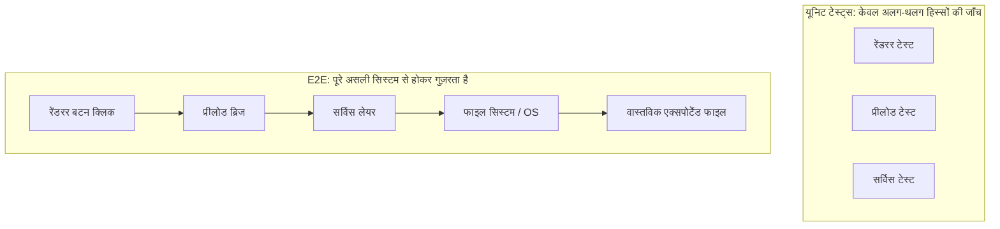
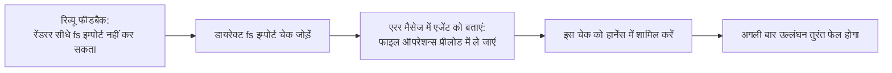

[English Version →](../../../en/lectures/lecture-10-why-end-to-end-testing-changes-results/)

> कोड उदाहरण: [code/](https://github.com/walkinglabs/learn-harness-engineering/blob/main/docs/hi/lectures/lecture-10-why-end-to-end-testing-changes-results/code/)
> प्रैक्टिकल प्रोजेक्ट: [Project 05. सेल्फ-वेरिफिकेशन और रोल सेपरेशन](./../../projects/project-05-grounded-qa-verification/index.md)

# लेक्चर 10. एंड-टू-एंड टेस्टिंग से नतीजे कैसे बदलते हैं

अधिकांश डेवलपर्स सोचते हैं कि टेस्टिंग केवल कोड में बग्स पकड़ने का एक ज़रिया है। लेकिन जब बात AI कोडिंग एजेंट्स की आती है, तो **एंड-टू-एंड (E2E) टेस्टिंग सिर्फ नतीजे नहीं बदलती — यह एजेंट के सोचने और कोड लिखने के पूरे व्यवहार को बदल देती है!**

## यूनिट टेस्ट्स के अंधे धब्बे (Blind Spots of Unit Tests)

यूनिट टेस्ट्स बहुत तेज़ और सस्ते होते हैं, लेकिन वे अलगाव (isolation) में चलते हैं। वे कभी नहीं देख पाते:
1. **कंपोनेंट इंटरेक्शन**: मॉड्यूल A और मॉड्यूल B दोनों अपने-अपने टेस्ट पास कर लेते हैं, लेकिन जब वे आपस में बात करते हैं तो डेटा का फॉर्मेट मिसमैच हो जाता है।
2. **रिसोर्स लाइफसाइकिल**: डेटाबेस कनेक्शन्स का लीक होना या फाइल हैंडल्स का बंद न होना।
3. **पर्यावरण का अंतर**: लोकल टेस्ट रनर बनाम वास्तविक रनटाइम एनवायरनमेंट।

## एंड-टू-एंड टेस्टिंग से एजेंट का व्यवहार कैसे बदलता है?

जब एजेंट को पता होता है कि उसके काम को एक पूर्ण E2E टेस्ट पाइपलाइन द्वारा जाँचा जाएगा:
1. वह केवल एक फ़ंक्शन को अलग-थलग लिखने के बजाय **अपस्ट्रीम और डाउनस्ट्रीम कनेक्शन** के बारे में सोचने लगता है।
2. वह **आर्किटेक्चरल सीमाओं का सम्मान** करने लगता है।
3. वह **एक्सेप्शन और एरर हैंडलिंग** को गंभीरता से लेता है।

## टेस्टिंग पिरामिड और रिव्यू फीडबैक को नियम में बदलना

## एजेंट-ओरिएंटेड एरर मैसेजेस (Agent-Oriented Error Messages)

OpenAI अपने Codex इंजीनियरिंग अनुभवों में ज़ोर देती है: **एजेंट्स के लिए लिखे गए एरर मैसेजेस में हमेशा फिक्स करने के निर्देश शामिल होने चाहिए!**

- ❌ केवल यह मत लिखिए: `"Direct filesystem access in renderer"`
- ✅ बल्कि यह लिखिए: `"Direct filesystem access in renderer. All file operations must go through the preload bridge. Move this call to preload/file-ops.ts and invoke it via window.api."`

यह आर्किटेक्चरल नियमों को एक **ऑटो-करेक्शन लूप** में बदल देता है।

## मूल अवधारणाएँ (Core Concepts)

- **कंपोनेंट बाउंड्री डिफेक्ट्स**: वे बग्स जो केवल घटकों के आपसी जुड़ाव पर सामने आते हैं।
- **आर्किटेक्चरल बाउंड्री एनफोर्समेंट**: नियमों को केवल दस्तावेज़ में रखने के बजाय ऑटोमैटिक लिटिंग और टेस्ट्स में बदलना।
- **रिव्यू फीडबैक प्रमोशन**: बार-बार आने वाले कोड रिव्यू कमेंट्स को स्वचालित टेस्ट्स में बदलना।
- **लेयर्ड डोमेन आर्किटेक्चर**: स्पष्ट लेयर्स (Types → Config → Repo → Service → Runtime → UI) जहाँ निर्भरता केवल आगे की दिशा में बहती है।

## इसे कैसे लागू करें? (How to Do It)

1. **E2E टेस्ट्स से पहले आर्किटेक्चरल सीमाएँ तय करें**: यदि आर्किटेक्चर उलझा हुआ है, तो E2E टेस्ट केवल यह साबित करेगा कि गड़बड़ चल रही है।
2. **इनवेरिएंट्स लागू करें, माइक्रोमैनेज न करें**: कड़े प्रतिबंध लगाएँ, लेकिन कार्यान्वयन की पूरी आज़ादी मॉडल को दें।
3. **CI/CD में ऑटोमैटिक E2E गेट्स रखें**: जब तक पूरा फ्लो पास न हो, कोड मर्ज न होने दें।

## मुख्य सीख (Key Takeaways)

- E2E टेस्टिंग सिर्फ बग्स नहीं पकड़ती, यह एजेंट के कोडिंग पैटर्न को अधिक ज़िम्मेदार बनाती है।
- एरर मैसेजेस में सुधार के निर्देश दें ताकि एजेंट खुद को ठीक कर सके।
- बार-बार मिलने वाले कोड रिव्यू फीडबैक को हार्नेस के नए नियम में प्रमोट करें।
- कड़े इनवेरिएंट्स + कार्यान्वयन की स्वतंत्रता = सबसे प्रभावी हार्नेस।

## आगे पढ़ें (Further Reading)

- [OpenAI: Harness engineering: leveraging Codex in an agent-first world](https://openai.com/index/harness-engineering/)
- [Martin Fowler: Testing Strategies in a Microservice Architecture](https://martinfowler.com/articles/microservice-testing/)

## अभ्यास (Exercises)

1. **आर्किटेक्चरल लिंट नियम जोड़ें**: अपने प्रोजेक्ट में एक कस्टम लिंट नियम जोड़ें जो रेंडरर में अनधिकृत इम्पोर्ट्स को रोके और स्पष्ट सुधार संदेश दे।
2. **पहला E2E फ्लो लिखें**: प्लेराइट या पपेटियर का उपयोग करके अपने प्रोजेक्ट के सबसे महत्वपूर्ण यूज़र फ्लो के लिए एक एंड-टू-एंड टेस्ट लिखें।
