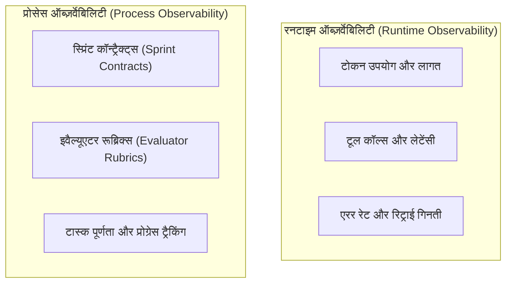

[English Version →](../../../en/lectures/lecture-11-why-observability-belongs-inside-the-harness/)

> कोड उदाहरण: [code/](https://github.com/walkinglabs/learn-harness-engineering/blob/main/docs/hi/lectures/lecture-11-why-observability-belongs-inside-the-harness/code/)
> प्रैक्टिकल प्रोजेक्ट: [Project 06. कम्पलीट हार्नेस कैपस्टोन](./../../projects/project-06-runtime-observability-and-debugging/index.md)

# लेक्चर 11. ऑब्ज़र्वेबिलिटी हार्नेस का हिस्सा क्यों होनी चाहिए

पारंपरिक सॉफ्टवेयर इंजीनियरिंग में, ऑब्ज़र्वेबिलिटी (Observability) का मतलब होता है: लॉग्स, मेट्रिक्स और ट्रेसिंग के ज़रिए प्रोडक्शन सिस्टम की सेहत पर नज़र रखना। लेकिन जब हम AI कोडिंग एजेंट्स की बात करते हैं, तो **ऑब्ज़र्वेबिलिटी सिर्फ एक निगरानी टूल नहीं है — यह हार्नेस का वह केंद्रीय तंत्र है जो तय करता है कि एजेंट सही दिशा में आगे बढ़ रहा है या नहीं।**

जब कोई एजेंट 30 मिनट तक स्क्रीन पर घूमता है, फाइल्स बदलता है, और टूल्स चलाता है — तो अगर आपके पास अंदरूनी ऑब्ज़र्वेबिलिटी नहीं है, तो आपके लिए वह एक ब्लैक बॉक्स है। आपको पता ही नहीं चलता कि वह किसी लूप में फँस गया है, टोकन फूँक रहा है, या असली प्रगति कर रहा है।

## ऑब्ज़र्वेबिलिटी न होने की असली कीमत (The Real Cost)

ऑब्ज़र्वेबिलिटी के अभाव में तीन सबसे बड़े नुकसान होते हैं:
1. **अंधा निष्पादन (Blind Execution)**: एजेंट 20 मिनट तक अपनी ही बनाई गलतियों को ठीक करने में उलझा रहता है और आपको अंत में सिर्फ एक भारी-भरकम API बिल मिलता है।
2. **डायग्नोसिस का अभाव**: जब टास्क फेल होता है, तो आप यह नहीं जान पाते कि मॉडल फेल हुआ, प्रॉम्प्ट खराब था, या कोई टूल टूट गया था।
3. **साइलेंट डिग्रेडेशन**: कोडबेस में धीरे-धीरे अप्रयुक्त फाइल्स, टूटे हुए टेस्ट्स और गंदा स्टेट जमा होता जाता है।

## लेयर्ड ऑब्ज़र्वेबिलिटी (Layered Observability)

हार्नेस में ऑब्ज़र्वेबिलिटी की दो मुख्य परतें होती हैं:



## मूल अवधारणाएँ (Core Concepts)

- **रनटाइम सिग्नल्स (Runtime Signals)**: निष्पादन के दौरान उत्पन्न होने वाले प्रत्यक्ष मेट्रिक्स (टोकन्स, लेटेंसी, टूल एग्ज़ीक्यूशन स्टेटस)।
- **प्रोसेस ऑब्ज़र्वेबिलिटी (Process Observability)**: यह मापना कि क्या एजेंट प्रोजेक्ट के नियमों, सीमाओं और वास्तुकला का पालन कर रहा है।
- **स्प्रिंट कॉन्ट्रैक्ट (Sprint Contract)**: हर टास्क से पहले एजेंट और हार्नेस के बीच एक लिखित समझौता — दायरा क्या है, क्या नहीं छूना है, और पास क्राइटेरिया क्या है।
- **इवैल्यूएटर रूब्रिक (Evaluator Rubric)**: स्वतंत्र चेकर एजेंट के लिए एक वस्तुनिष्ठ स्कोरकार्ड।

## ऑब्ज़र्वेबिलिटी कैसे बनाएँ? (How to Build Observability)

### 1. रनटाइम सिग्नल कलेक्शन को हार्नेस में शामिल करें
हार्नेस को हर टूल कॉल, एग्ज़िट कोड और टोकन खपत को एक संरचित लॉग फ़ाइल में रिकॉर्ड करना चाहिए।

### 2. स्प्रिंट कॉन्ट्रैक्ट्स लागू करें (Sprint Contracts)
हर टास्क से पहले स्पष्ट सीमाएँ तय करें:
```markdown
# Sprint Contract: Dark Mode Support
## Scope
- केवल src/theme/ और src/components/ की फाइल्स को बदलें
- डार्क मोड टॉगल बटन जोड़ें
## Verification Standards
- npm test tests/theme.test.ts 100% पास हो
- कोई नई डिपेंडेंसी न जोड़ी जाए
## Exclusions
- बैकएंड API या डेटाबेस फाइल्स को बिल्कुल न छुएँ
```

### 3. इवैल्यूएटर रूब्रिक स्थापित करें (Evaluator Rubric)
स्वतंत्र समीक्षक के लिए स्पष्ट स्कोरिंग गाइड:
- क्या कोड बिना किसी चेतावनी के कंपाइल होता है? (हाँ/नहीं)
- क्या सभी टेस्ट्स पास हैं? (हाँ/नहीं)
- क्या स्कोप से बाहर कोई बदलाव किया गया? (हाँ/नहीं)

### 4. OpenTelemetry या स्ट्रक्चर्ड लॉग्स से मानकीकरण करें
मशीन-पठनीय JSON फॉर्मेट में लॉग्स रखें ताकि बाद में ऑटोमैटिक टूल्स इनका विश्लेषण कर सकें।

## Anthropic का 3-एजेंट आर्किटेक्चर (एक असली केस स्टडी)

Anthropic के रेट्रो-गेम प्रयोग में:
- **प्लानर**: टास्क को छोटे स्प्रिंट कॉन्ट्रैक्ट्स में तोड़ता है।
- **जनरेटर**: केवल दिए गए स्प्रिंट कॉन्ट्रैक्ट पर कोड लिखता है।
- **इवैल्यूएटर**: प्लेराइट से असली स्क्रीन पर क्लिक करके और लॉग्स देखकर वेरिफाई करता है।

इस पूर्ण ऑब्ज़र्वेबिलिटी के कारण ही 6 घंटे तक चलने वाला लंबा प्रोजेक्ट बिना भटके सफल हुआ।

## मुख्य सीख (Key Takeaways)

- बिना ऑब्ज़र्वेबिलिटी के लंबे समय तक चलने वाले एजेंट्स पर भरोसा नहीं किया जा सकता।
- रनटाइम सिग्नल्स (टोकन्स, एरर्स) और प्रोसेस सिग्नल्स (स्प्रिंट कॉन्ट्रैक्ट्स) दोनों आवश्यक हैं।
- हर टास्क से पहले एक स्पष्ट स्प्रिंट कॉन्ट्रैक्ट लिखें।
- इवैल्यूएटर रूब्रिक से काम की वस्तुनिष्ठ जाँच करें।

## आगे पढ़ें (Further Reading)

- [Anthropic: Effective Harnesses for Long-Running Agents](https://www.anthropic.com/engineering/effective-harnesses-for-long-running-agents)
- [OpenTelemetry Architecture](https://opentelemetry.io/docs/concepts/what-is-opentelemetry/)

## अभ्यास (Exercises)

1. **स्प्रिंट कॉन्ट्रैक्ट लिखें**: अपने अगले टास्क के लिए स्कोप, इनवेरिएंट्स और एक्सक्लूज़न वाला एक स्प्रिंट कॉन्ट्रैक्ट तैयार करें।
2. **रनटाइम लॉगर बनाएँ**: एक साधारण स्क्रिप्ट लिखें जो एजेंट की टूल कॉल्स और टेस्ट परिणामों को JSON में लॉग करे।
