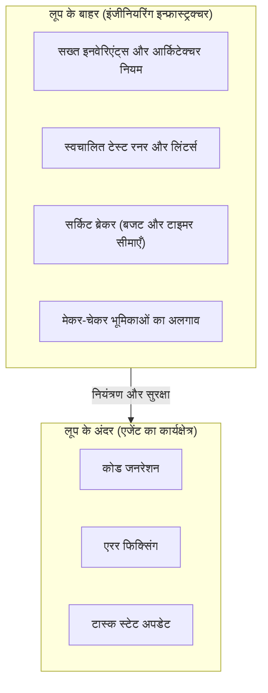

[English Version →](../../../en/lectures/lecture-13-loop-engineering/)

> कोड उदाहरण: [code/](https://github.com/walkinglabs/learn-harness-engineering/blob/main/docs/hi/lectures/lecture-13-loop-engineering/code/)
> प्रैक्टिकल प्रोजेक्ट: [Project 07. पहला ऑटोमेटेड लूप](./../../projects/project-07-loop-engineering-first-loop/index.md)

# लेक्चर 13. मैन्युअल प्रॉम्प्टिंग से ऑटोनॉमस लूप्स तक

अब तक के लेक्चर्स में आपने सीखा कि एजेंट को निर्देश कैसे दें, स्टेट कैसे संभालें, और कोड कैसे वेरिफाई करें। लेकिन हर बार एजेंट के सामने बैठकर प्रॉम्प्ट टाइप करना, रिज़ल्ट देखना और अगला निर्देश देना — यह "मैन्युअल ड्राइविंग" है। असली क्रांति तब शुरू होती है जब आप एजेंट को एक **ऑटोनॉमस लूप (Autonomous Loop)** में छोड़ते हैं: आप रात को सोएँ, और एजेंट खुद ब खुद कोड लिखे, टेस्ट करे, गलतियाँ सुधारे, और सुबह तक काम पूरा करके दे।

इसे हम कहते हैं: **लूप इंजीनियरिंग (Loop Engineering)**।

## `/goal`: सबसे सरल ऑटोमैटिक लूप (/goal: The Simplest Possible Loop)

`/goal` कोई जादुई कमांड नहीं है; यह एक सीधा-सादा लूप है:
1. एक लक्ष्य (Goal) तय करो।
2. रुकने की एक स्पष्ट शर्त (Stopping Condition) दो।
3. एजेंट को तब तक चलने दो जब तक शर्त पूरी न हो जाए।

### `/goal` का विकास कैसे हुआ
शुरुआत में डेवलपर्स बार-बार "अगला काम करो", "टेस्ट चलाओ", "फिक्स करो" प्रॉम्प्ट करते थे। फिर समझ आया कि इस दोहराव को एक स्वचालित लूप में बाँधा जा सकता है।

### लूप्स के कई रूप हैं
- **Goal Loop**: लक्ष्य पूरा होने तक चलता है।
- **Periodic Loop (`/loop`)**: एक निश्चित समय अंतराल (जैसे हर 30 मिनट) पर बार-बार चलता है।

### `/goal` और `/loop` में भ्रमित न हों
- `/goal` एक बार शुरू होता है और लक्ष्य हासिल होते ही रुक जाता है (One-off Task)।
- `/loop` एक आवधिक क्रॉन जॉब (Recurring Job) है जो निरंतर निगरानी या रखरखाव करता है।

## लूप के अंदर बनाम लूप के बाहर (Inside vs. Outside the Loop)

लूप इंजीनियरिंग का सबसे महत्वपूर्ण सिद्धांत यह समझना है कि क्या लूप के अंदर होना चाहिए और क्या लूप के बाहर:



- **लूप के अंदर**: केवल कोड लिखने और फिक्स करने का काम।
- **लूप के बाहर**: सुरक्षा घेरा, बजट सीमाएँ, और सत्यापन का कड़ा पहरा।

## मूल अवधारणाएँ (Core Concepts)

- **ऑटोनॉमस लूप**: एक स्व-सत्यापित चक्र जो बिना मानवीय हस्तक्षेप के लक्ष्य प्राप्त होने तक चलता रहता है।
- **रुकने की शर्त (Stopping Condition)**: वह वस्तुनिष्ठ कसौटी जिसके पूरा होने पर लूप स्वतः समाप्त हो जाता है।
- **मेकर-चेकर अलगाव (Maker-Checker Separation)**: कोड लिखने वाला एजेंट और कोड जाँचने वाला एजेंट कभी एक नहीं होने चाहिए।
- **सर्किट ब्रेकर (Circuit Breaker)**: एक सुरक्षा तंत्र जो अत्यधिक टोकन खर्च या अंतहीन लूप की स्थिति में लूप को तुरंत बंद कर देता है।

## लूप के 6 बुनियादी पुर्ज़े (The Six Primitives of a Loop)

एक मजबूत ऑटोनॉमस लूप बनाने के लिए 6 घटकों की आवश्यकता होती है:

### 1. Automations — लूप की धड़कन (The Heartbeat)
शेड्यूलर या बैकग्राउंड ट्रिगर्स जो लूप को सक्रिय रखते हैं।
```bash
# हर 30 मिनट में टेस्ट चलाओ और फेलियर फिक्स करो
/loop 30m "run npm test and fix failures"
```

### 2. Worktrees — बड़े पैमाने पर अलगाव (Isolation at Scale)
गिट वर्कट्रीज़ के ज़रिए हर लूप को एक स्वच्छ और अलग-थलग डायरेक्टरी दें ताकि मुख्य कोड सुरक्षित रहे।

### 3. Skills — बार-बार समझाने से मुक्ति
पुनः प्रयोज्य ज्ञान (Reusable Workflows) को स्किल्स के रूप में लोड करें ताकि लूप शुरू होते ही एजेंट पूरी प्रक्रिया जान ले।

### 4. Connectors — असली टूल्स से संपर्क
डेटाबेस, API, और ब्राउज़र से सुरक्षित रूप से जुड़ने के साधन।

### 5. Sub-agents — मेकर को चेकर से दूर रखें
कोड लिखने का काम सब-एजेंट A करे, और निष्पक्ष जाँच सब-एजेंट B करे।

### 6. External State — लूप की याददाश्त (Memory)
लूप की स्थिति को फाइल्स (`progress.md`, `feature_list.json`) में स्टोर करें ताकि क्रैश होने पर भी ज्ञान न खोए।

## जनरेटर/इवैल्यूएटर अलगाव (Maker vs Checker)

मॉडल को कभी अपना खुद का काम नहीं जाँचने देना चाहिए। Anthropic के शोध से सिद्ध है कि एक स्वतंत्र इवैल्यूएटर एजेंट ही वास्तविक गुणवत्ता सुनिश्चित कर सकता है।

## कार्पैथी का autoresearch: लूप का एक आदर्श उदाहरण (Karpathy's autoresearch)

Andrej Karpathy का `autoresearch` प्रोजेक्ट लूप इंजीनियरिंग का सबसे बेहतरीन उदाहरण है:
- **तीन फाइल्स, तीन भूमिकाएँ**: `program.md` (लक्ष्य और नियम), `train.py` (कोड), और `results.tsv` (परिणाम)।
- **9-स्टेप शाफ़्ट लूप**: हर बार एक छोटा बदलाव → ट्रेन करो → इवैल्यूएट करो → अगर सुधार हुआ तो गिट कमिट करो, अगर बिगड़ा तो गिट रिवर्ट करो!
- **सबसे खास बात**: पूरा लूप किसी जटिल C++ या Python फ्रेमवर्क में नहीं, बल्कि सीधे अंग्रेज़ी निर्देशों और शैल स्क्रिप्ट्स में लिखा गया है।

## चार खामोश खतरे (The Four Silent Costs)

जब आप लूप चलाते हैं, तो ये चार खतरे चुपचाप आपके प्रोजेक्ट को नुकसान पहुँचा सकते हैं:

1. **सत्यापन ऋण (Verification Debt)**: जब टेस्ट्स केवल सतही हों और अंदरूनी बग्स छिपते चले जाएँ।
2. **समझ का सड़ना (Comprehension Rot)**: जब एजेंट इतना ज़्यादा कोड जनरेट कर दे कि इंसान खुद न समझ पाए कि कोड में क्या चल रहा है।
3. **संज्ञानात्मक समर्पण (Cognitive Surrender)**: जब डेवलपर सोचना बंद कर दे और एजेंट के हर आउटपुट पर आँख मूँदकर भरोसा कर ले।
4. **टोकन का विस्फोट (Token Blowout)**: अनियंत्रित लूप्स के कारण कुछ ही घंटों में सैकड़ों डॉलर्स का बिल बन जाना।

## अपना पहला लूप कैसे बनाएँ (Building Your First Loop)

1. **स्टेप 1: एक दोहराव वाला टास्क चुनें**: जैसे बग फिक्सिंग या टेस्ट कवरेज बढ़ाना।
2. **स्टेप 2: लक्ष्य और रुकने की शर्त लिखें**: "कवरेज 80% होने पर रुकें।"
3. **स्टेप 3: मेकर और चेकर को अलग करें**: एक एजेंट लिखे, दूसरा जाँचे।
4. **स्टेप 4: मेमोरी जोड़ें**: प्रगति को फ़ाइल में लिखें।
5. **स्टेप 5: टाइमर और बजट सीमा लगाएँ**: अधिकतम 10 चक्र या $10 का बजट।

## मुख्य सीख (Key Takeaways)

- लूप इंजीनियरिंग मैन्युअल प्रॉम्प्टिंग से स्वायत्त विकास की ओर छलांग है।
- लूप के बाहर कड़ा पहरा (Rules & Verification) होना चाहिए, लूप के अंदर केवल निष्पादन।
- मेकर और चेकर को अलग रखना अनिवार्य है।
- चार खामोश खतरों (खासकर टोकन विस्फोट और समझ के सड़ने) से हमेशा सावधान रहें।

## आगे पढ़ें (Further Reading)

- [Andrej Karpathy: autoresearch](https://github.com/karpathy/autoresearch)
- [Anthropic: Effective Harnesses for Long-Running Agents](https://www.anthropic.com/engineering/effective-harnesses-for-long-running-agents)

## अभ्यास (Exercises)

1. **एक साधारण Goal Loop बनाएँ**: एक शेल स्क्रिप्ट लिखें जो तब तक लूप में टेस्ट चलाए और एजेंट से कोड फिक्स करवाए जब तक सारे टेस्ट पास न हो जाएँ (अधिकतम 5 चक्र)।
2. **सर्किट ब्रेकर जोड़ें**: लूप में टाइमआउट और बजट लिमिट जोड़ें।
