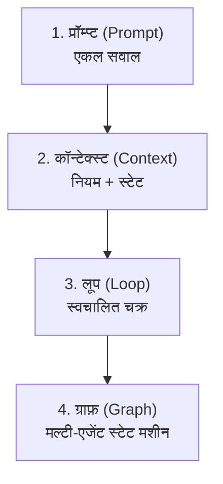

[English Version →](../../../en/lectures/lecture-14-graph-engineering/)

> कोड उदाहरण: [code/](https://github.com/walkinglabs/learn-harness-engineering/blob/main/docs/hi/lectures/lecture-14-graph-engineering/code/)
> प्रैक्टिकल प्रोजेक्ट: [Project 08. वर्कफ़्लो को ग्राफ़ में बदलें](./../../projects/project-08-graph-engineering-first-graph/index.md)

# लेक्चर 14. सिंगल लूप से ग्राफ इंजीनियरिंग तक

पिछले लेक्चर में आपने लूप इंजीनियरिंग सीखी। एक सिंगल लूप छोटे और मध्यम आकार के टास्क्स के लिए बहुत कारगर होता है। लेकिन जब प्रोजेक्ट बड़ा होता है, जिसमें कई अलग-अलग भूमिकाएँ (आर्किटेक्ट, कोडर, रिव्यूअर, सुरक्षा परीक्षक) होती हैं, तो एक ही लूप में सब कुछ समेटना असंभव हो जाता है।

यहाँ जन्म होता है: **ग्राफ़ इंजीनियरिंग (Graph Engineering)** का।

## प्रॉम्प्ट, कॉन्टेक्स्ट, लूप, और ग्राफ़: एक ही इमारत की 4 मंज़िलें

AI एजेंट आर्किटेक्चर को आप चार स्तरों में समझ सकते हैं:

1. **Prompt**: एक एकल निर्देश (Single Instruction)।
2. **Context**: प्रॉम्प्ट के साथ रिपॉजिटरी का इतिहास और नियम जोड़ना।
3. **Loop**: प्रॉम्प्ट और कॉन्टेक्स्ट को एक स्वतः चलने वाले चक्र में दोहराना।
4. **Graph**: कई अलग-अलग लूप्स और एजेंट्स को एक संगठित नेटवर्क में जोड़ना।



## ग्राफ़ के 4 बुनियादी हिस्से (Nodes, Edges, State, Routing)

एक एजेंटिक ग्राफ़ चार बुनियादी पुर्ज़ों से मिलकर बनता है:

1. **Nodes (नोड्स)**: विशिष्ट कार्य करने वाले घटक — यह एक एजेंट, एक टूल, या एक शेल कमांड हो सकता है (जैसे `PlanNode`, `CodeNode`, `ReviewNode`)।
2. **Edges (एजेस)**: नोड्स के बीच का रास्ता जो तय करता है कि अगला कदम कौन सा होगा।
3. **State (अवस्था)**: साझा स्मृति (Shared Memory) जो पूरे ग्राफ़ में सभी नोड्स के बीच बहती है।
4. **Routing Rules (राउटिंग नियम)**: निर्णय बिंदु (Conditional Edges) जो तय करते हैं कि आगे बढ़ना है, पीछे लौटना है, या काम समाप्त करना है।

## सिंगल लूप कब छोटा पड़ने लगता है? (When a Loop Stops Being Enough)

जब आप एक ही लूप को बहुत बड़े काम सौंपते हैं, तो तीन संरचनात्मक विफलताएँ सामने आती हैं:

1. **गुडहार्ट का नियम (Goodhart's Law)**: जब कोई पैमाना खुद लक्ष्य बन जाता है, तो वह उपयोगी नहीं रहता। एजेंट टेस्ट पास करने के लिए टेस्ट्स को ही कमजोर कर देता है।
2. **ऊपर की ओर अंधापन (Blindness Upward)**: लूप यह कभी नहीं सोच पाता कि "क्या यह लक्ष्य ही गलत है?" वह एक गलत लक्ष्य की दिशा में पूरी ताकत से भागता रहता है।
3. **लूप्स का आपसी टकराव (Conflict)**: जब दो स्वतंत्र लूप्स एक ही कोडबेस में समानांतर चलते हैं, तो वे एक-दूसरे के बदलावों को ओवरराइट करने लगते हैं।

## ग्राफ़ बनाम पारंपरिक वर्कफ़्लो (Graph vs Workflow)

- पारंपरिक वर्कफ़्लो एक सीधी रेखा (Pipeline: A → B → C) होती है।
- ग्राफ़ एक गतिशील स्टेट मशीन होती है जहाँ निर्णय के आधार पर पीछे मुड़ा जा सकता है, समानांतर शाखाएँ खोली जा सकती हैं, और असफल होने पर पुनर्विचार किया जा सकता है।

## अपना पहला ग्राफ़ शुरुआत से बनाएँ (Build Your First Graph)

यहाँ एक क्लासिक मेकर-चेकर ग्राफ़ का ढाँचा है:

```python
# maker_checker_graph.py
from typing import TypedDict, Literal

class GraphState(TypedDict):
    task: str
    code: str
    review_feedback: str
    iterations: int
    is_approved: bool

def plan_node(state: GraphState) -> GraphState:
    # योजना बनाना
    return {"plan": "..."}

def code_node(state: GraphState) -> GraphState:
    # कोड लिखना या सुधारना
    return {"code": "...", "iterations": state["iterations"] + 1}

def review_node(state: GraphState) -> GraphState:
    # स्वतंत्र समीक्षा और टेस्ट चलाना
    is_passed = run_e2e_tests()
    return {"is_approved": is_passed, "review_feedback": "..."}

def route_after_review(state: GraphState) -> Literal["approved", "retry", "abort"]:
    if state["is_approved"]:
        return "approved"
    if state["iterations"] > 5:
        return "abort"
    return "retry"
```

## सोने का नियम (The Golden Rule)

**ज़रूरत पड़ने से पहले ग्राफ़ मत बनाइए!**
अगर एक साधारण प्रॉम्प्ट काम कर सकता है, तो प्रॉम्प्ट इस्तेमाल करें। अगर एक छोटा लूप काफी है, तो लूप चलाएँ। ग्राफ़ इंजीनियरिंग की जटिलता तभी अपनाएँ जब आपके पास वास्तव में कई स्वतंत्र भूमिकाएँ और जटिल निर्णय शाखाएँ हों।

## मुख्य सीख (Key Takeaways)

- ग्राफ़ इंजीनियरिंग जटिल मल्टी-एजेंट सिस्टम्स को नियंत्रित करने की सर्वोच्च कला है।
- ग्राफ़ के 4 स्तंभ: Nodes, Edges, State, और Routing।
- सिंगल लूप्स बड़े पैमाने पर गुडहार्ट लॉ और टकराव के शिकार हो जाते हैं।
- हमेशा सबसे सरल आर्किटेक्चर से शुरुआत करें; जब सिस्टम सीमाओं से टकराए तभी ग्राफ़ जोड़ें।

## आगे पढ़ें (Further Reading)

- [LangGraph: Multi-Agent Workflows](https://langchain-ai.github.io/langgraph/)
- [Anthropic: Building Effective Agents](https://www.anthropic.com/research/building-effective-agents)

## अभ्यास (Exercises)

1. **मेकर-चेकर ग्राफ़ तैयार करें**: Python या किसी स्टेट मशीन टूल से एक साधारण ग्राफ़ बनाएँ जो कोड लिखने, टेस्ट करने और अप्रूवल की 3 अवस्थाओं को प्रबंधित करे।
2. **सर्किट ब्रेकर जोड़ें**: अधिकतम 5 रिट्राइज़ के बाद ग्राफ़ को सुरक्षित रूप से समाप्त करने वाला कंडीशनल एज बनाएँ।
