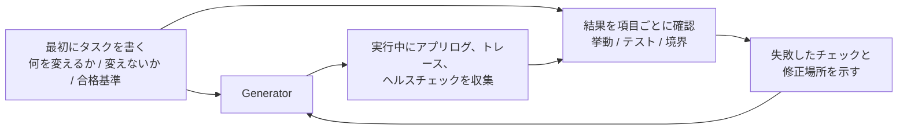

[中文版本 →](../../../zh/lectures/lecture-11-why-observability-belongs-inside-the-harness/)

> コード例: [code/](https://github.com/walkinglabs/learn-harness-engineering/blob/main/docs/ja/lectures/lecture-11-why-observability-belongs-inside-the-harness/code/)
> 実践プロジェクト: [プロジェクト 06. 完全な harness（総合課題）](./../../projects/project-06-runtime-observability-and-debugging/index.md)

# 講義 11. エージェントのランタイムを観測可能にする

## この講義が解決する問題

エージェントに機能実装を頼むと、20 分走って大量のファイルを変更し、「完了しました。ただしテストが 2 つ失敗しています」と言ってきます。なぜ失敗しているのか聞くと「よくわかりません。タイミング問題かもしれません」。どの重要経路を変えたのか聞くと「コードを見てみます……」。

これはエージェントの能力不足ではありません。harness が十分な観測性を提供していないことが問題です。**観測性がなければ、エージェントは不確実なまま意思決定し、評価は主観的判断になり、再試行は手探りになります。** OpenAI も Anthropic も、信頼性を証拠の問題として扱っています。harness は、次の判断を導ける形でランタイム挙動と評価信号を露出しなければなりません。

## 中核概念

- **ランタイム観測性**: ログ、トレース、プロセスイベント、ヘルスチェックなどのシステムレベル信号。「システムが何をしたか」に答える。
- **プロセス観測性**: 計画、採点ルーブリック、受け入れ基準など、harness の判断成果物への可視性。「なぜこの変更を受け入れるべきか」に答える。
- **タスクトレース**: タスク開始から完了までの判断経路の完全な記録。分散システムのリクエストトレースに近い。エージェントの各ステップと文脈を記録する。
- **スプリント契約**: コーディング開始前に合意する短期契約。タスク範囲、検証基準、除外項目を明記する。プロセス観測性の中核ツール。
- **評価ルーブリック**: 品質評価を主観判断から証拠ベースの構造化スコアに変える。同じ出力に対して評価者が近い結果を出せるようにする。
- **階層化された観測性**: システム層とプロセス層の観測性を同時に設計し、相互に補強する。ランタイム信号は挙動を説明し、プロセス成果物は意図を説明する。

## 階層化された観測性



## なぜこれが起きるのか

### 観測性不足の本当のコスト

harness に観測性がないと、4 種類の問題が体系的に発生します。

**「正しい」と「正しそう」を区別できない**: コードレビュー上は完璧に見える関数でも、ランタイムでは特定入力のエッジケースで誤った結果を返すことがあります。実際の実行経路が期待から外れたことは、ランタイムトレースでしか見えません。

**評価が神秘主義になる**: 採点ルーブリックと受け入れ基準がないと、評価者（人間でもエージェントでも）は暗黙の前提に頼ります。同じ出力でも評価者によって判断が大きく変わり、品質評価が再現不能になります。

**再試行が盲目的な推測になる**: 失敗理由がわからないと、再試行の方向はランダムになります。本当の原因を無視して関係ないコード経路を直し続けるかもしれません。盲目的な再試行はすべてトークンと時間を消費します。

**セッション引き継ぎの情報断崖**: 未完了の作業を次セッションに渡すとき、観測性がないと新しいセッションはシステム状態をゼロから診断し直す必要があります。新しいセッションはコードを読み直し、コマンドを再実行し、どの信号が重要かを判断しなければなりません。[バージョン管理された進捗と検証記録](https://www.anthropic.com/engineering/effective-harnesses-for-long-running-agents)があれば、検査可能な状態が手に入ります。

### Claude Code での現実的なシナリオ

「アプリにダークモードを追加する」タスクを、planner-generator-evaluator の 3 役割 workflow で実行する harness を想像してください。

**観測性なし**: planner は曖昧な説明を出します。generator はその曖昧さをもとにダークモードを実装しますが、planner の暗黙期待と合いません。evaluator は自分の暗黙基準で却下しますが、具体的に何が悪いか説明できません。generator は曖昧な却下理由をもとに手探りで再試行します。これが 3-4 回繰り返され、45 分ほどかかり、かろうじて受け入れ可能な出力になります。

**完全な観測性あり**: planner はスプリント契約を出します。どのコンポーネントを変更するか、各コンポーネントの検証基準、除外項目（印刷スタイルは扱わない等）を列挙します。generator は契約に従って実装します。ランタイム観測性は各コンポーネントのスタイル読み込みと適用過程を記録します。evaluator は採点ルーブリックで次元ごとに評価し、証拠を引用します。1 回の反復で高品質な結果が出て、約 15 分で終わります。

違いは、契約と証拠が agent の頭の外に存在するかどうかから来ます。

### エージェントだけでは解決できない理由

「エージェント自身にログを出させればよいのでは」と思うかもしれません。問題は次のとおりです。

1. エージェントは自分が何を知らないかを知らないため、必要な信号を自発的に記録しません。
2. ログ形式が一貫しません。セッションごとに形式が違うと、体系的な分析ができません。
3. プロセス観測性はログだけでは解決できません。スプリント契約や採点ルーブリックは、harness レベルの支援を必要とする構造化成果物です。

## 正しく行う方法

### 1. ランタイム信号収集を harness に組み込む

エージェントが自分でログを出すことに頼らないでください。harness が次の信号を自動収集すべきです。

- **アプリケーションライフサイクル**: 起動、ready、running、shutdown の各状態
- **機能経路の実行**: 重要経路の入口、チェックポイント、出口の記録
- **データフロー**: コンポーネント間を流れるデータの記録
- **リソース利用**: メモリが増え続けるなど異常な利用パターン
- **エラーと例外**: エラーメッセージだけでなく完全な文脈

### 2. スプリント契約を実装する

各タスクの開始前に、generator と evaluator（同じエージェントの別呼び出しでもよい）が契約を合意します。

```markdown
# Sprint Contract: Dark Mode Support

## Scope
- Modify the theme toggle component
- Update global CSS variables
- Add dark mode tests

## Verification Standards
- Visual regression tests pass for each component
- Main flow end-to-end tests pass
- No flash of unstyled content (FOUC)

## Exclusions
- Not handling print styles
- Not handling third-party component dark mode
```

### 3. 評価ルーブリックを整備する

「良いか悪いか」を定量的な採点に変えます。

```markdown
# Scoring Rubric

| Dimension | A | B | C | D |
|-----------|---|---|---|---|
| Code correctness | All tests pass | Main flow passes | Partial pass | Build fails |
| Architecture compliance | Fully compliant | Minor deviations | Obvious deviations | Serious violations |
| Test coverage | Main + edge cases | Main flow only | Only skeleton | No tests |
```

### 4. OpenTelemetry で標準化する

各 harness セッションに trace、各タスクに span、各検証ステップに sub-span を作ります。標準属性で重要情報を注釈します。これにより、観測性データを Jaeger や Zipkin などの標準ツールチェーンに統合できます。

## 実例

planner-generator-evaluator workflow の harness で「ダークモード対応を追加する」場合です。

**観測不能な版**: 盲目的な再試行が 3-4 回、45 分、かろうじて許容できる出力。evaluator は「何か違う」と言うだけで具体化できず、generator は大きな時間を誤った方向に使います。

**完全に観測可能な版**:
- スプリント契約が範囲、基準、除外項目を明確化
- ランタイムトレースが各コンポーネントのスタイル読み込み過程を記録
- 採点ルーブリックが次元ごとの構造化評価を提供
- 1 回の反復で高品質な結果、15 分

契約と証拠が手元にあれば、品質はより安定し、評価は再現可能になります。

## 重要なポイント

- **観測性は harness のアーキテクチャ属性**です。後から足す機能ではなく、設計時に考慮すべき中核能力です。
- **2 つの観測性レイヤーはどちらも必須**です。ランタイム信号は「何が起きたか」を説明し、プロセス成果物は「なぜそうしたか」を説明します。
- **スプリント契約は事前に認識を揃える**ため、「generator が作ったものを evaluator が予見可能な理由で即却下する」事態を防ぎます。
- **採点ルーブリックは評価を再現可能にする**ため、異なる評価者でも同じ出力に近いスコアを出せます。
- **観測性は、曖昧な却下を具体的で修正可能な欠陥に変えます。**

## 参考資料

- [Observability Engineering - Charity Majors](https://www.honeycomb.io/blog/observability-engineering-book) — 現代的な observability engineering の理論と実践
- [Dapper - Google (Sigelman et al.)](https://research.google/pubs/pub36356/) — 大規模分散トレーシングの先駆的実践
- [Harness Design - Anthropic](https://www.anthropic.com/engineering/harness-design-long-running-apps) — スプリント契約と evaluator rubric の導入
- [Site Reliability Engineering - Google](https://sre.google/sre-book/table-of-contents/) — 本番システムにおける観測性の体系的応用

## 演習

1. **観測性ギャップ分析**: 現在の harness をシステム層とプロセス層の観測性で監査します。既存信号では区別できないシステム状態を見つけ、追加案を出してください。

2. **スプリント契約練習**: 実タスクのスプリント契約を書きます。エージェントに契約に従って実行させ、契約あり/なしで効率と品質を比較してください。

3. **タスクトレース構築**: 完全なコーディングタスク中のエージェント操作をすべて記録します。OpenTelemetry の semantic conventions で注釈し、どのステップで判断に必要な信号が不足しているかを分析してください。
