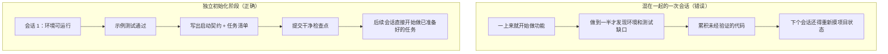

[English Version →](../../../en/lectures/lecture-06-why-initialization-needs-its-own-phase/)

> 本篇代码示例：[code/](https://github.com/walkinglabs/learn-harness-engineering/blob/main/docs/zh/lectures/lecture-06-why-initialization-needs-its-own-phase/code/)
> 实战练习：[Project 03. 让 agent 关掉再打开还能接着干](./../../projects/project-03-multi-session-continuity/index.md)

# 第六讲. 让 agent 每次工作前先初始化

在使用 AI 编码 agent 时，一个常见的低效模式是：让 agent 直接开始做功能，它上来就写代码，但很快会发现测试框架没配好、环境有问题、项目结构不清晰，大量时间花在了"搞清楚这个项目怎么运作"上面，真正用于写功能的时间反而很少。

更好的做法是，在让 agent 开始干活之前，先用一个独立的阶段把基础环境搭好、验证命令跑通、项目结构搞清楚。初始化工作应该和功能实现分开，它们是两种性质完全不同的任务。

这节课要讨论的，就是为什么初始化必须是独立的阶段，不能跟实现混在一起。

## 两种不同的工作

初始化和实现的优化目标完全不同。实现阶段的目标是最大化已验证功能的数量和质量，初始化阶段的目标则是最大化后续所有实现的可靠性和效率。

当你把初始化和实现混在一起的时候，agent 面临一个多目标优化问题：它要同时搭基础设施和写功能代码。在没有显式优先级设定的情况下，agent 自然倾向于写代码（因为那是直接可见的产出），而牺牲基础设施（因为它的价值只能在后续会话中体现）。结果就是基础设施没搭牢，功能代码的可靠性也打了折扣。

## 初始化生命周期



## 初始化与实现同时进行的问题

最直接的问题是基础设施搭不牢。Agent 把大部分精力花在功能代码上，基础设施只是顺手搭一点。测试框架配了但没验证过，lint 规则设了但太宽松，进度文件没创建。这些缺陷在第一个会话里不明显（因为 agent 还记得它做了什么），但到第二个会话就暴露了：新 agent 不知道项目怎么跑、怎么测、做到哪了。

更隐蔽的代价是"未验证的累积"。在测试框架配好之前写的功能代码，等回头补测试的时候可能发现设计上就有问题，早知道的话应该用不同的方式实现。前面写的代码越多，后面需要推翻重来的就越多。

上下文预算也在被浪费。初始化工作（配环境、配测试、理解项目结构）消耗了大量预算，留给实际功能实现的反而不够了。结果第一个会话只完成了一半的功能，第二个会话还得从头理解项目。预算花在了初始化上，但初始化也没做好，两头都没占着。

最容易被忽略的是隐式假设埋下的雷。Agent 在初始化过程中做的决策（用什么测试框架、目录怎么组织、依赖怎么管理）如果不显式记录下来，后续会话就可能做出矛盾的选择。第一个会话选了 Vitest 做测试框架，第二个会话的 agent 不知道，又引入了 Jest，两套测试框架共存，维护成本翻倍。

Anthropic 的长运行 agent 工作[把初始化放在独立的第一个会话里](https://www.anthropic.com/engineering/effective-harnesses-for-long-running-agents)：initializer 写 `init.sh`、进度文件、功能清单和初始 commit；后续 coding 会话读取这些状态，一次做一个功能，端到端测试，提交并更新进度。

OpenAI 的 Codex harness engineering 指南也强调"仓库作为操作记录"的原则：第一次运行就要建立清晰的操作结构，否则每次新会话都得重新推断项目约定。

## 核心概念

- **初始化阶段**：agent 生命周期中的第一个阶段，只建立后续实现所需的执行前提，不做功能开发。它的产出是基础设施，而不是业务代码。
- **启动就绪清单**：一个项目能被全新 agent 会话无歧义操作的条件：能启动、能测试、能看进度、能接手下一步。四个条件缺一不可。
- **从零开始 vs 从模板开始**：从零开始意味着 agent 需要自行推断项目结构，效果差；从模板开始意味着基础设施已经就位，效果好得多。能用模板就用模板。
- **随时可接手**：项目在任何时刻都处于"可以被全新 agent 接手"的状态。不需要口头解释，只看仓库内容就能接着干。
- **从开始到第一次测试通过**：衡量初始化效率的核心指标。时间越短，初始化越高效。
- **后续会话的成功率**：后续会话不需要依赖隐式知识就能成功执行任务的比例，这是初始化质量的最佳衡量标准。

## 初始化的正确做法

**把初始化当作一个独立的阶段来执行。** 第一个会话只做初始化，不写任何业务功能代码。初始化的产出是：

**1. 可运行的环境。** 项目能启动、依赖都装好、没有环境问题。

**2. 可验证的测试框架。** 至少有一个示例测试能通过，证明测试框架本身是配好的。

**3. 启动就绪清单文档。** 一个明确的文档告诉后续会话：
```markdown
# 初始化契约

## 启动命令
- 安装依赖：`make setup`
- 启动开发服务器：`make dev`
- 运行测试：`make test`
- 完整验证：`make check`

## 当前状态
- 所有依赖已安装并锁定
- 测试框架已配置（Vitest + React Testing Library）
- 示例测试通过（1/1）
- Lint 规则已配置（ESLint + Prettier）

## 项目结构
- src/ — 源代码
- src/components/ — React 组件
- src/api/ — API 客户端
- tests/ — 测试文件
```

**4. 任务分解。** 把整个项目拆成有序的任务列表，每个任务有明确的验收标准：
```markdown
# 任务分解

## Task 1: 用户认证基础
- 实现 JWT 认证中间件
- 添加登录/注册端点
- 验收标准：pytest tests/test_auth.py 全部通过

## Task 2: 用户资料页面
- 实现用户资料 CRUD
- 添加资料编辑表单
- 验收标准：pytest tests/test_profile.py 全部通过

## Task 3: 搜索功能
- ...
```

**5. Git 提交作为检查点。** 初始化完成后提交一个干净的 checkpoint。后续所有工作都从这个 checkpoint 开始。

**热启动策略**：不要从空目录开始。用一个项目模板（create-react-app、fastapi-template 等）预置好标准的目录结构、依赖配置和测试框架。把通用的初始化步骤预置到模板里，只留下项目特有的初始化工作。

**初始化的完成条件**：启动就绪清单的四个条件全部满足——能启动、能测试、能看进度、能接手下一步。用这个检查清单验收初始化：

```markdown
## 初始化验收清单
- [ ] `make setup` 从零开始能成功
- [ ] `make test` 至少有一个测试通过
- [ ] 新的 agent 会话能只看仓库回答"怎么跑"和"怎么测"
- [ ] 任务分解文件存在且有至少 3 个任务
- [ ] 所有内容已提交到 git
```

## 实际案例

一个 React 前端项目的两种初始化方式对比：

**混合方式**：agent 在第一个会话中同时做了项目脚手架创建和首个功能实现。会话结束时，仓库有可运行的代码，但没有显式的启动和测试命令文档、没有进度跟踪文件、没有任务分解。第二个会话花了约 20 分钟推断项目结构、测试框架和构建流程。

**独立初始化**：第一个会话只做初始化，用项目模板创建目录结构、配置测试框架（Vitest + React Testing Library）、写一个示例测试并验证通过、创建启动就绪清单文档和任务分解文件、提交初始检查点。第二个会话的重建时间不到 3 分钟，直接从任务列表开始工作。

整个项目周期对比：混合方式的总重建时间（跨所有会话）比独立初始化多约 60%。独立初始化多花的那 20 分钟在后续会话中被成倍收回。前期多投入一点时间把初始化做扎实，后续的效率反而更高。

## 核心要点

- 初始化和实现的优化目标不同，混在一起只会互相拖后腿。
- 初始化的产出是基础设施：可运行的环境、可验证的测试、启动就绪清单、任务分解。
- 用"启动就绪清单"的四个条件验收初始化：能启动、能测试、能看进度、能接手下一步。
- 热启动优于冷启动，用项目模板预置标准化的基础设施。
- 初始化投入的时间会在后续 3-4 个会话中完全收回，这是前期投资，不是额外成本。

## 延伸阅读

- [Anthropic: Effective Harnesses for Long-Running Agents](https://www.anthropic.com/engineering/effective-harnesses-for-long-running-agents)
- [OpenAI: Harness Engineering](https://openai.com/index/harness-engineering/)
- [HumanLayer: Harness Engineering for Coding Agents](https://www.humanlayer.dev/blog/skill-issue-harness-engineering-for-coding-agents)
- [Infrastructure as Code — Martin Fowler](https://martinfowler.com/bliki/InfrastructureAsCode.html)
- [SWE-agent: Agent-Computer Interfaces](https://github.com/princeton-nlp/SWE-agent)

## 练习

1. **启动就绪清单设计**：为你正在开发的项目写一个完整的启动就绪清单。然后开一个全新的 agent 会话，只给它看仓库内容（不给任何口头上下文），让它尝试启动项目、跑测试、了解当前进度。记录它遇到的问题，每个问题都对应启动就绪清单中缺失的一个条款。

2. **对比实验**：选一个中等复杂度的新项目。方式 A 让 agent 初始化和首次实现同时做，方式 B 先花一个会话做独立初始化，第二个会话再开始实现。在 4 个会话后对比首次验证时间、重建成本和功能完成率。

3. **初始化验收清单**：为你的项目设计一个初始化验收清单，让一个全新的 agent 会话逐项执行，记录哪些项通过了、哪些没通过。没通过的项就是 harness 需要补强的地方。
